# SynapseSync

> **An AI-powered, offline-first study companion that transforms Google Drive documents and YouTube lecture playlists into exhaustively detailed Markdown notes, adaptive quizzes, and SM-2 spaced repetition flashcards.**

[](#)
[](./LICENSE)
[](#)
[](https://nextjs.org/)
[](https://python.org/)
[](https://aistudio.google.com/)
[](#)

---

## Table of Contents

- [Overview](#overview)
- [Key Features](#key-features)
- [Architecture & Design Principles](#architecture--design-principles)
- [Prerequisites](#prerequisites)
- [Installation & Setup](#installation--setup)
- [Running Locally (End-to-End)](#running-locally-end-to-end)
  - [1. Configure Environment Variables](#1-configure-environment-variables)
  - [2. Start the Local Web App & API](#2-start-the-local-web-app--api)
  - [3. Run the Local YouTube Pipeline CLI](#3-run-the-local-youtube-pipeline-cli)
- [Core Workflows](#core-workflows)
  - [Google Drive Document Ingestion](#google-drive-document-ingestion)
  - [YouTube Transcript Ingestion (Local-First)](#youtube-transcript-ingestion-local-first)
  - [Quiz & Flashcard Generation](#quiz--flashcard-generation)
  - [Spaced Repetition System (SM-2)](#spaced-repetition-system-sm-2)
  - [AI Study Assistant (Chat)](#ai-study-assistant-chat)
- [Project Structure](#project-structure)
- [Tech Stack](#tech-stack)
- [Documentation Index](#documentation-index)
- [Contributing](#contributing)
- [License](#license)

---

## Overview

SynapseSync solves the study friction experienced by self-directed learners, students, and professionals:
- **No fragmented workflows:** Reading lecture notes, watching video playlists, creating flashcards, and scheduling reviews are unified in one place.
- **Offline-First:** All notes, quizzes, flashcards, review histories, and SM-2 states are stored locally in the browser via **IndexedDB** — allowing full study sessions on commutes or flights without an internet connection.
- **Local-First YouTube Pipeline:** Transcript fetching and detailed note generation run locally on your development machine using residential IPs, bypassing cloud datacenter IP blocks and serverless timeout limits.
- **Exhaustive Notes, Not Summaries:** Gemini is instructed as a meticulous note-taker, capturing every definition, concept, formula, and example in formatted Markdown.

---

## Key Features

- 📁 **Google Drive Integration:** Authenticate via Google OAuth 2.0 with full read and write capabilities (`https://www.googleapis.com/auth/drive`). Browse nested folders, import `.docx`, `.md`, and Google Docs files into local IndexedDB, and create or update notes directly in Google Drive.
- 🎬 **Local YouTube Lecture Processing:** Ingest entire multi-video playlists via a Python CLI tool. Generates complete, structured Markdown notes for every lecture.
- 🤖 **Structured AI Quizzing:** One-click generation of 5 multiple-choice questions (with explanations) and 5 flashcards per note, using Gemini structured outputs.
- 🧠 **SuperMemo SM-2 Spaced Repetition:** Scientifically schedules daily card reviews based on your recall quality (ratings 0–5), with an interactive review queue and streak tracking.
- 💬 **Context-Aware Study Chat:** Scoped AI assistant for every note with specialized modes (*Default*, *ELI5 / Explain to a 5-Year-Old*, and *Quiz Me*).
- 📱 **Installable PWA:** Installs to desktop and mobile home screens with app-shell caching, smooth dark/light theme, and offline capability.

---

## Architecture & Design Principles

```mermaid
graph TB
    subgraph "Developer Machine (Local-First Pipeline)"
        CLI["YouTube CLI Tool (Python)"]
        YTApi["YouTube Transcript API (Residential IP)"]
        GeminiLocal["Gemini API (No Timeout Constraints)"]
        LocalCache["Local Disk Cache (~/.synapse-sync/)"]

        CLI --> YTApi
        CLI --> GeminiLocal
        CLI --> LocalCache
    end

    subgraph "Local Dev / Vercel Serverless"
        API_YT["/api/youtube-notes"]
        API_PARSE["/api/parse-docx"]
        API_QUIZ["/api/generate-quiz"]
        API_CHAT["/api/chat"]
        API_SUM["/api/summarize"]
    end

    subgraph "Client PWA (Browser / Mobile)"
        UI["Next.js App Router (PWA)"]
        IDB[("IndexedDB (Offline Storage)")]
        GAUTH["Google OAuth 2.0 (Drive API)"]
    end

    CLI -->|Pushes Processed Notes| API_YT
    UI <-->|Fetch Pushed Notes| API_YT
    UI <-->|Local Read/Write| IDB
    UI -->|Import Files| GAUTH
    UI -->|Parse Word Docs| API_PARSE
    UI -->|Generate Quizzes| API_QUIZ
    UI -->|Ask Questions| API_CHAT
```



- **Strict OOP Architecture:** Modular services, single-responsibility classes, typed schemas, and no magic strings.
- **Zero Heavy UI Bloat:** Pure Vanilla CSS with centralized design tokens for optimal load performance and aesthetic polish.

---

## Prerequisites

Before running the application, ensure your environment meets the following requirements:

- **Node.js:** `20.0.0` or higher
- **npm:** `9.0.0` or higher
- **Python:** `3.13` (configured with the designated project environment: `~/python_envs/p313_llm`)
- **uv:** Fast Python package installer (`uv pip`)
- **Google Gemini API Key:** Free tier from [Google AI Studio](https://aistudio.google.com/)
- **Google Client ID:** (Optional for YouTube-only usage, required for Google Drive sync) Registered OAuth 2.0 Client ID from [Google Cloud Console](https://console.cloud.google.com/)

---

## Installation & Setup

### 1. Clone Repository

```bash
git clone https://github.com/Strider221B/synapse-sync.git
cd synapse-sync
```

### 2. Install Frontend Dependencies

```bash
npm install
```

### 3. Activate Python Virtual Environment

```bash
source ~/python_envs/p313_llm/bin/activate
```

### 4. Install Python Backend Dependencies (using uv pip)

```bash
# Serverless API dependencies
uv pip install -r api/requirements.txt

# Local YouTube CLI dependencies
uv pip install -r tools/youtube_cli/requirements.txt
```

---

## Running Locally (End-to-End)

Follow these steps to run the complete stack locally on your computer:

### 1. Configure Environment Variables

Create a `.env.local` file in the project root:

```bash
cp .env.local.example .env.local
```

Populate the required secrets:

```env
# Gemini API Key (Required for AI quizzing, chat, and note generation)
GEMINI_API_KEY=<YOUR_GEMINI_API_KEY>

# Shared Secret for Local CLI -> Server API Push
YOUTUBE_NOTES_API_KEY=local-dev-secret-key-12345

# Base URL for API calls
NEXT_PUBLIC_API_URL=http://localhost:3000

# Google OAuth 2.0 (Optional for local testing without Google Drive)
NEXT_PUBLIC_GOOGLE_CLIENT_ID=<YOUR_GOOGLE_CLIENT_ID>
NEXT_PUBLIC_GOOGLE_REDIRECT_URI=http://localhost:3000
```

> [!NOTE]
> **Understanding `YOUTUBE_NOTES_API_KEY`:**
> - **What it is:** This is **not** an official key from Google or YouTube. It is a **shared secret / password** that you choose yourself to protect the `/api/youtube-notes` endpoint so only authorized callers can push notes to your web application.
> - **For Local Development:** Any arbitrary string is fine (e.g. `local-dev-secret-key-12345`).
> - **For Production (Vercel):** Generate a strong random token (e.g., `openssl rand -hex 32`) and save it in your Vercel project environment variables.
> - **Important:** The value set on your server (in `.env.local` or Vercel) **must match** the `YOUTUBE_NOTES_API_KEY` exported in your terminal when running the CLI pusher (`tools.youtube_cli`).

### 2. Start the Local Web App & API

You can start the local development server using either Next.js or Vercel CLI (which runs both Next.js and Python serverless functions concurrently):

#### Option A: Using Vercel CLI (Recommended for full Python function parity)
```bash
# Install Vercel CLI globally if not already installed
npm install -g vercel

# Run the dev server
vercel dev
```

#### Option B: Using npm
```bash
npm run dev
```

Open your browser to [http://localhost:3000](http://localhost:3000) to view the SynapseSync interface.

---

### 3. Run the Local YouTube Pipeline CLI

When you want to ingest a YouTube lecture or playlist, run the local CLI tool:

```bash
# Make sure the Python virtual environment is activated
source ~/python_envs/p313_llm/bin/activate

# Set environment variables for the CLI session (or place in .env)
export GEMINI_API_KEY="<YOUR_GEMINI_API_KEY>"
export YOUTUBE_NOTES_API_KEY="local-dev-secret-key-12345"
export SYNAPSE_SERVER_URL="http://localhost:3000"
```

#### Ingest a Single Video:
```bash
python -m tools.youtube_cli.main process --url "https://www.youtube.com/watch?v=jGwO_UgTS7I"
```

#### Ingest an Entire Playlist (e.g., Stanford CS229):
```bash
python -m tools.youtube_cli.main process --url "https://www.youtube.com/playlist?list=PLoROMvodv4rMiGQp3WXShtMGgzqpfVfbU"
```

#### What happens during execution:
1. **Transcript Fetching:** Captures captions locally via `youtube-transcript-api` (uses your residential IP to avoid rate limits).
2. **Local Caching:** Caches raw transcripts in `~/.synapse-sync/transcript_cache/<video_id>.json`.
3. **Exhaustive Note Generation:** Streams transcript to Gemini to produce comprehensive Markdown notes covering all concepts, definitions, and code examples.
4. **Local Markdown File Saving:** Saves Markdown notes to `~/.synapse-sync/processed_notes/<playlist_slug>/`. You can open and read these in Obsidian or VS Code.
5. **Server Push:** Posts the structured notebook and notes to `POST /api/youtube-notes` on your running local server.
6. **In-App Availability:** Open the web app at `http://localhost:3000/notes` to view the notebook and its lecture notes.

---

## Core Workflows

### Google Drive Document Ingestion & Export
1. Click **Connect Google Drive** in the app header or notes view.
2. Sign in via Google OAuth 2.0 popup.
3. Browse Google Drive folders, select `.docx`, `.md`, or Google Docs files, and click **Import Selected**.
4. Word documents are parsed via `/api/parse-docx`, Google Docs are exported as clean text, and notes are stored in IndexedDB.
5. In addition to reading, you can write and synchronize notes directly back to Google Drive (create new markdown files via multipart upload or update existing file content).

> [!TIP]
> **Google Drive Folder Structure:** You do not need to place files in any special folder. You can store your documents anywhere in Google Drive (or inside organized subfolders like `Study/Course_Name/`). The in-app file browser navigates through your folders starting at root `My Drive` and lists all eligible documents.

### YouTube Transcript Ingestion (Local-First)
- Ingest playlists via the local Python CLI (`python -m tools.youtube_cli.main process --url ...`).
- If you only have a single video transcript, you can also paste it directly into the web UI via the **YouTube** tab fallback.

### Quiz & Flashcard Generation
1. Open any lecture or document note in the **Note Reader** (`/notes/[id]`).
2. Click **Generate Quiz**.
3. Gemini processes the note text and returns 5 multiple-choice questions (with explanations) and 5 flashcards.
4. Quizzes are stored in IndexedDB and can be retaken at any time.

### Spaced Repetition System (SM-2)
1. Navigate to the **Review** tab (`/review`).
2. The queue displays all flashcards and MCQs due for review today (`nextReview <= today`).
3. Flip flashcards or answer questions, then rate your recall quality:
   - `0`: Blackout (Reset interval)
   - `1`: Incorrect
   - `2`: Incorrect, but easy
   - `3`: Correct, difficult
   - `4`: Correct, hesitation
   - `5`: Perfect recall
4. The SuperMemo SM-2 algorithm recalibrates Easiness Factor (`EF`), interval, and next review date.

### AI Study Assistant (Chat)
1. Click **Ask AI** while reading any note.
2. Select your desired persona mode:
   - **Default:** Precise answers grounded strictly in the note text.
   - **Explain (ELI5):** Analogies and simple explanations for beginners.
   - **Quiz Me:** AI asks follow-up questions to test your understanding.
3. Conversation histories persist locally per note.

---

## Project Structure

```
synapse-sync/
├── api/                              # Vercel Python Serverless Functions
│   ├── parse_docx.py                 # .docx XML extraction
│   ├── youtube_notes.py              # Stores & serves CLI-pushed YouTube notes
│   ├── generate_quiz.py              # Gemini structured output quiz generator
│   ├── summarize.py                  # Gemini detailed note generator (fallback)
│   ├── chat.py                       # Context-scoped study assistant
│   └── requirements.txt              # Cloud API dependencies
│
├── tools/                            # Local Developer CLI Tools
│   └── youtube_cli/                  # YouTube ingestion pipeline
│       ├── main.py                   # CLI entry point (argparse / rich)
│       ├── transcript_fetcher.py     # youtube-transcript-api wrapper
│       ├── playlist_resolver.py      # Playlist to video metadata resolver
│       ├── note_generator.py         # Gemini exhaustive note generator
│       ├── server_pusher.py          # HTTP client for pushing notes to API
│       ├── transcript_cache.py       # Local file-based caching
│       ├── config.py                 # Config & environment constants
│       └── requirements.txt          # CLI dependencies
│
├── src/                              # Frontend Next.js Application
│   ├── app/                          # App Router pages
│   │   ├── layout.tsx                # Root layout + PWA manifest links
│   │   ├── page.tsx                  # Dashboard & streak widget
│   │   ├── notes/                    # Notes index & reader view
│   │   ├── quiz/                     # Quiz selection & taking interface
│   │   ├── review/                   # SM-2 daily review queue
│   │   ├── youtube/                  # YouTube notes viewer & fallback
│   │   ├── chat/                     # Note-scoped AI chat
│   │   └── settings/                 # App settings & Google Drive auth
│   │
│   ├── components/                   # Modular UI Components
│   │   ├── layout/                   # Sidebar, BottomNav, Header
│   │   ├── notes/                    # NoteCard, NoteReader, GoogleDrivePicker
│   │   ├── quiz/                     # MCQCard, FlashCard, QuizResults
│   │   ├── review/                   # ReviewCard, QualityRating, ReviewStats
│   │   └── common/                   # ThemeToggle, ErrorBoundary, Skeleton
│   │
│   ├── lib/                          # Application Core Services
│   │   ├── db/                       # IndexedDB schemas & CRUD service classes
│   │   ├── srs/                      # Pure SM-2 calculation engine
│   │   ├── auth/                     # Google OAuth 2.0 authentication
│   │   └── api/                      # Resilient HTTP client with retry logic
│   │
│   └── styles/
│       └── globals.css               # Design tokens & responsive styles
│
├── public/                           # Static assets & PWA files
│   ├── manifest.json                 # Web App Manifest
│   ├── sw.js                         # Serwist Service Worker
│   └── offline.html                  # Offline fallback template
│
├── documentation/                    # Project Documentation
│   ├── design/high_level/            # High-level architecture & design specs
│   ├── plans/                        # Detailed epic execution plans
│   └── prompts/                      # Coding standards & conventions
│
├── vercel.json                       # Deployment & serverless config
├── package.json                      # Node.js dependencies & scripts
├── tsconfig.json                     # Strict TypeScript configuration
└── LICENSE                           # MIT License
```

---

## Tech Stack

| Layer | Technologies |
|:------|:-------------|
| **Frontend Framework** | [Next.js 16.4.2](https://nextjs.org/) (App Router), React 19.3.1, TypeScript 7.0.2 |
| **Styling & Design** | Vanilla CSS with CSS Custom Properties (Design Tokens), Dark/Light Themes |
| **Local Offline Storage**| [IndexedDB](https://developer.mozilla.org/en-US/docs/Web/API/IndexedDB_API) via [`idb@8.0.4`](https://github.com/jakearchibald/idb) |
| **PWA & Caching** | Serwist 9.5.13 ([`@serwist/next@9.5.13`](https://serwist.pages.dev/)), Web App Manifest, Cache-First & Network-First strategies |
| **Backend Runtime** | Python 3.13 Serverless Functions (Vercel) |
| **AI Engine** | [Google Gemini 2.0 Flash](https://aistudio.google.com/) via `google-generativeai==0.8.6` with Structured Output |
| **Cloud Authentication**| Google OAuth 2.0 with Google Drive API v3 |
| **Local CLI Pipeline** | Python 3.13 (`uv pip`), `youtube-transcript-api==1.2.4`, `rich==15.0.0`, `requests==2.34.2` |
| **Code Quality** | ESLint, TypeScript (`tsc`), Ruff 0.16.9, Pytest 9.1.1 |

---

## Documentation Index

Detailed specifications and architectural decisions can be found in the documentation directory:

### High-Level Design
- [01. Product Requirements](./documentation/design/high_level/01_product_requirements.md)
- [02. System Architecture](./documentation/design/high_level/02_system_architecture.md)
- [03. Data Models & IndexedDB Schema](./documentation/design/high_level/03_data_models.md)
- [04. API Specifications](./documentation/design/high_level/04_api_specifications.md)
- [05. Deployment & Infrastructure Guide](./documentation/design/high_level/05_deployment_guide.md)
- [06. Design Overview & ADRs](./documentation/design/high_level/06_design_overview.md)

### Execution Plans
- [00. Plan Overview & Dependency Graph](./documentation/plans/00_plan_overview.md)
- [01. Epic 1 — Project Foundation & Scaffolding](./documentation/plans/01_project_foundation.md)
- [02. Epic 2 — Client-Side Data Layer (IndexedDB)](./documentation/plans/02_data_layer.md)
- [03. Epic 3 — Google Drive Integration & Note Management](./documentation/plans/03_onedrive_notes.md)
- [04. Epic 4 — YouTube Transcript Ingestion (Local-First)](./documentation/plans/04_youtube_ingestion.md)
- [05. Epic 5 — AI-Powered Quiz & Flashcard Generation](./documentation/plans/05_quiz_generation.md)
- [06. Epic 6 — Spaced Repetition System (SM-2)](./documentation/plans/06_spaced_repetition.md)
- [07. Epic 7 — AI Study Assistant (Chat)](./documentation/plans/07_ai_chat.md)
- [08. Epic 8 — PWA & Offline-First Implementation](./documentation/plans/08_pwa_offline.md)
- [09. Epic 9 — Polish, Theming & UI Enhancements](./documentation/plans/09_polish_enhancements.md)

### Standards
- [Coding Standards & Conventions](./documentation/prompts/coding_standards.md)

---

## Contributing

Contributions and ideas are welcome! Please ensure all code conforms to our [Coding Standards](./documentation/prompts/coding_standards.md) (strict OOP, 90%+ test coverage, passing `ruff` and `npm run lint`).

---

## License

This project is licensed under the MIT License — see the [LICENSE](./LICENSE) file for details.
