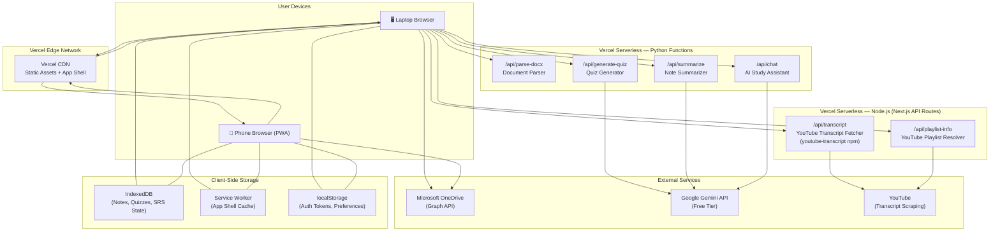
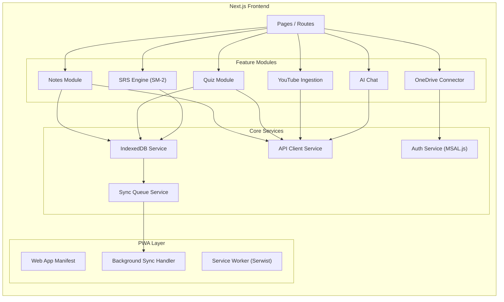
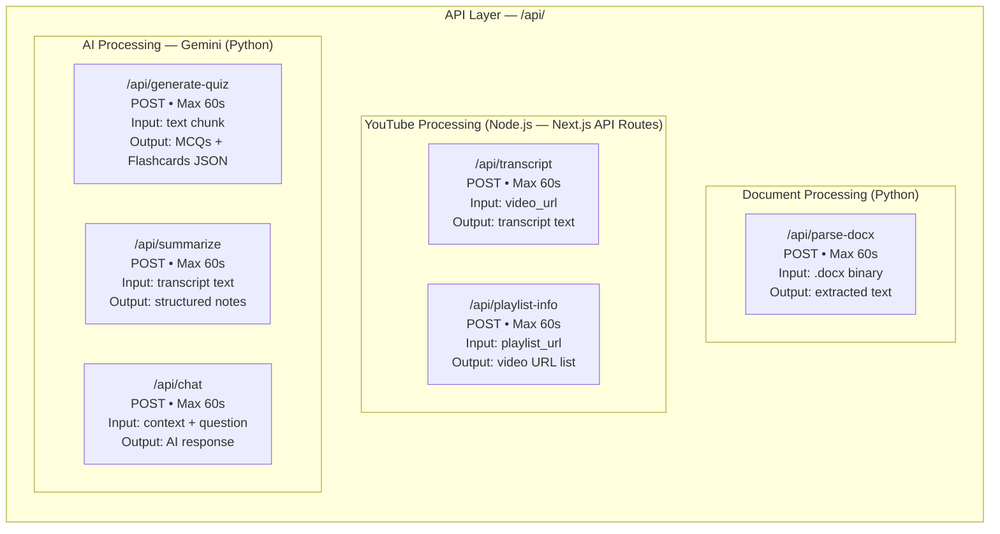
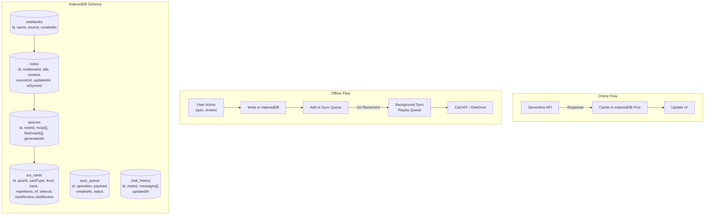
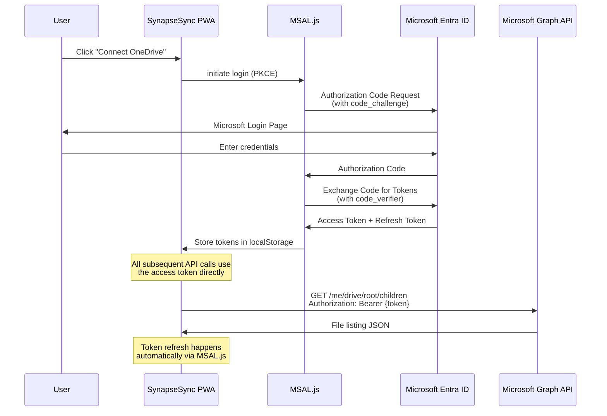
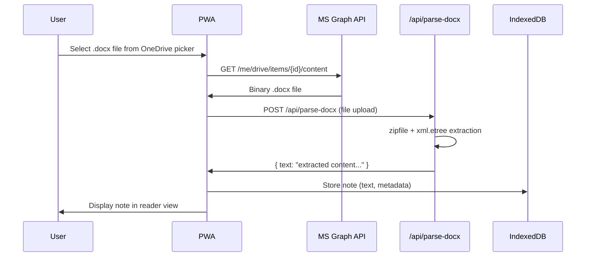
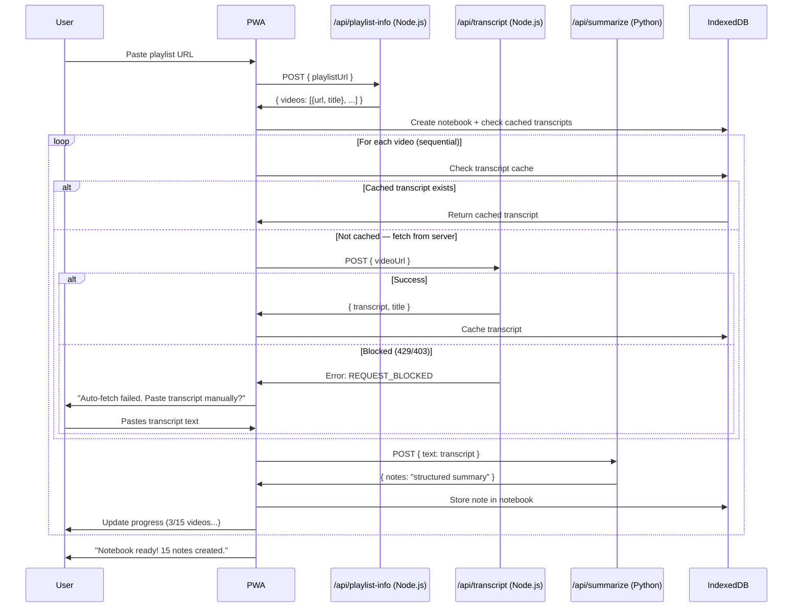
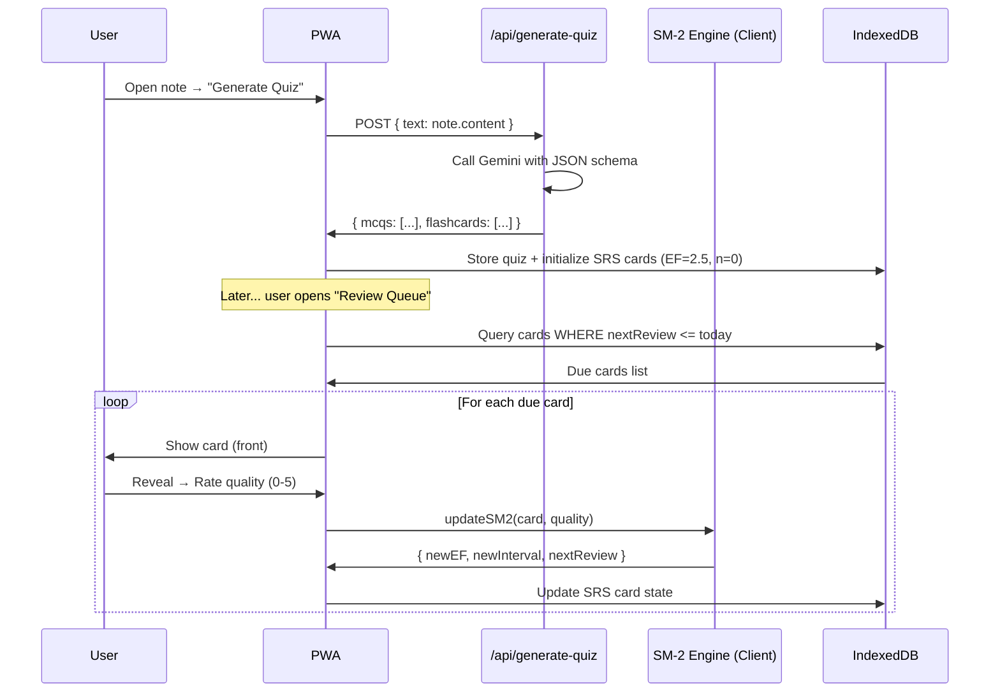

# SynapseSync — System Architecture Document

> **Version:** 1.0  
> **Date:** 2026-09-10  
> **Status:** Draft  

---

## 1. Architecture Overview

SynapseSync follows an **offline-first, client-heavy architecture** where the browser (PWA) is the primary runtime and Vercel Python serverless functions serve as lightweight, stateless processing endpoints.



---

## 2. Architectural Principles

| Principle                    | Rationale                                                                |
|:-----------------------------|:-------------------------------------------------------------------------|
| **Offline-First**            | User travels frequently; IndexedDB is the source of truth               |
| **Client-Heavy / Server-Thin** | Vercel free tier has strict limits; minimize server work                |
| **Stateless Backend**        | Serverless functions have no persistent memory between invocations       |
| **Micro-Request Pattern**    | Every API call must complete within 60 seconds; one unit of work per call|
| **Progressive Enhancement**  | Core features work offline; AI features enhance when online              |

---

## 3. Component Architecture

### 3.1 Frontend: Next.js (React) PWA

The frontend is a **Next.js application** deployed to Vercel as static/SSR pages. It handles all user interaction, state management, and offline capabilities.



#### Key Frontend Responsibilities

| Responsibility               | Implementation                                                          |
|:-----------------------------|:------------------------------------------------------------------------|
| Authentication               | MSAL.js handles OAuth PKCE flow; tokens in `localStorage`              |
| OneDrive file browsing       | Direct calls to Microsoft Graph API from browser (delegated auth)       |
| Note rendering               | Parse Markdown/extracted text; render with `react-markdown`             |
| Quiz taking & scoring        | Entirely client-side; results stored in IndexedDB                       |
| SM-2 algorithm execution     | Pure client-side computation — no server roundtrip needed               |
| Offline data management      | IndexedDB as primary store; sync queue for pending operations           |
| YouTube playlist orchestration | Frontend loops through video URLs, calling `/api/transcript` per video |

### 3.2 Backend: Hybrid Node.js + Python Serverless Functions

The backend uses a **hybrid runtime strategy**: YouTube transcript fetching runs as a **Next.js API route (Node.js)** using the `youtube-transcript` npm package, while AI processing and document parsing run as **Python serverless functions**.

> [!IMPORTANT]
> **Why Node.js for YouTube transcripts?** Direct client-side browser fetching from YouTube is **blocked by CORS** — browsers refuse cross-origin requests to YouTube's transcript endpoints. The request must be proxied through a server-side route. Using a Next.js API route (Node.js) keeps the transcript logic in the same deployment as the frontend, while still using the user's Vercel deployment as the proxy.

Each function is a **micro-scoped, stateless endpoint** that performs one focused task and returns structured JSON.



#### Endpoint Specifications

| Endpoint              | Runtime   | Method | Input                         | Output                          | Gemini? | Max Time |
|:----------------------|:----------|:-------|:------------------------------|:--------------------------------|:--------|:---------|
| `/api/parse-docx`     | Python    | POST   | `.docx` file (multipart)     | `{ text: string }`             | No      | ~5s      |
| `/api/transcript`     | **Node.js** | POST | `{ videoUrl: string }`       | `{ transcript: string, title }` | No      | ~15s     |
| `/api/playlist-info`  | **Node.js** | POST | `{ playlistUrl: string }`    | `{ videos: [{url, title}] }`   | No      | ~10s     |
| `/api/generate-quiz`  | Python    | POST   | `{ text: string }`           | `{ mcqs: [], flashcards: [] }` | Yes     | ~20s     |
| `/api/summarize`      | Python    | POST   | `{ text: string }`           | `{ notes: string }`            | Yes     | ~15s     |
| `/api/chat`           | Python    | POST   | `{ context, question, history }` | `{ answer: string }`       | Yes     | ~10s     |

> [!NOTE]
> **Manual paste fallback:** If the Node.js transcript endpoint fails (due to YouTube IP blocking), the UI provides a text area for users to manually paste a transcript. The raw text is then sent directly to `/api/summarize` for AI processing.

### 3.3 Offline-First Data Layer



---

## 4. Authentication Architecture



> [!IMPORTANT]
> **No tokens are ever sent to or stored on the Vercel backend.** The browser communicates directly with Microsoft Graph API using delegated permissions. The Python serverless functions never need OneDrive access — the browser downloads file content and sends it to `/api/parse-docx`.

---

## 5. Data Flow Diagrams

### 5.1 OneDrive → Notes Flow



### 5.2 YouTube → Notes Flow (Dual-Path)



### 5.3 Quiz Generation & SRS Flow



---

## 6. Project Structure

```
synapse-sync/
├── api/                              # Vercel Python Serverless Functions
│   ├── parse_docx.py                 # .docx text extraction
│   ├── generate_quiz.py              # Gemini quiz generation
│   ├── summarize.py                  # Gemini note summarization
│   ├── chat.py                       # Gemini study assistant
│   └── requirements.txt              # Python dependencies
│
├── src/                              # Next.js Frontend Source
│   ├── app/                          # App Router pages
│   │   ├── layout.tsx                # Root layout + PWA meta
│   │   ├── page.tsx                  # Dashboard / Home
│   │   ├── api/                      # Next.js API Routes (Node.js)
│   │   │   ├── transcript/
│   │   │   │   └── route.ts          # YouTube transcript fetcher (Node.js)
│   │   │   └── playlist-info/
│   │   │       └── route.ts          # YouTube playlist resolver (Node.js)
│   │   ├── notes/
│   │   │   ├── page.tsx              # Notes listing
│   │   │   └── [id]/page.tsx         # Note reader view
│   │   ├── quiz/
│   │   │   ├── page.tsx              # Quiz selection
│   │   │   └── [id]/page.tsx         # Quiz taking interface
│   │   ├── review/
│   │   │   └── page.tsx              # SRS daily review queue
│   │   ├── youtube/
│   │   │   └── page.tsx              # YouTube import page
│   │   ├── chat/
│   │   │   └── page.tsx              # AI study assistant
│   │   └── settings/
│   │       └── page.tsx              # Settings & OneDrive connection
│   │
│   ├── components/                   # Reusable UI Components
│   │   ├── layout/
│   │   │   ├── Sidebar.tsx
│   │   │   ├── BottomNav.tsx         # Mobile navigation
│   │   │   └── Header.tsx
│   │   ├── notes/
│   │   │   ├── NoteCard.tsx
│   │   │   ├── NoteReader.tsx
│   │   │   └── OneDrivePicker.tsx
│   │   ├── quiz/
│   │   │   ├── MCQCard.tsx
│   │   │   ├── FlashCard.tsx
│   │   │   └── QuizResults.tsx
│   │   ├── youtube/
│   │   │   ├── PlaylistImporter.tsx   # Playlist URL input + progress
│   │   │   └── TranscriptPaster.tsx   # Manual paste fallback UI
│   │   ├── review/
│   │   │   ├── ReviewCard.tsx
│   │   │   └── ReviewStats.tsx
│   │   └── common/
│   │       ├── ProgressBar.tsx
│   │       ├── SearchBar.tsx
│   │       └── ThemeToggle.tsx
│   │
│   ├── lib/                          # Core Libraries
│   │   ├── db/
│   │   │   ├── indexeddb.ts          # IndexedDB wrapper (idb)
│   │   │   ├── schema.ts            # Database schema definitions
│   │   │   └── sync.ts              # Sync queue management
│   │   ├── srs/
│   │   │   └── sm2.ts               # SM-2 algorithm implementation
│   │   ├── auth/
│   │   │   └── msal.ts              # MSAL.js configuration
│   │   ├── api/
│   │   │   └── client.ts            # API client with retry logic
│   │   └── utils/
│   │       ├── markdown.ts           # Markdown rendering helpers
│   │       └── youtube.ts            # YouTube URL parsing
│   │
│   └── styles/
│       └── globals.css               # Design system tokens + global styles
│
├── public/
│   ├── manifest.json                 # PWA manifest
│   ├── sw.js                         # Service Worker
│   ├── icons/                        # PWA icons (multiple sizes)
│   └── offline.html                  # Offline fallback page
│
├── vercel.json                       # Vercel deployment configuration
├── next.config.js                    # Next.js configuration
├── package.json                      # Includes youtube-transcript npm dep
├── tsconfig.json
└── documentation/
    ├── prompts/
    │   └── 000_high_level.md
    └── design/
        └── high_level/
            ├── 01_product_requirements.md
            ├── 02_system_architecture.md
            ├── 03_data_models.md
            ├── 04_api_specifications.md
            ├── 05_deployment_guide.md
            └── 06_design_overview.md
```

---

## 7. Technology Stack Summary

| Layer                | Technology                  | Justification                                              |
|:---------------------|:----------------------------|:-----------------------------------------------------------|
| **Frontend Framework** | Next.js 14+ (App Router)  | SSR + static generation; native Vercel support             |
| **UI Library**       | React 18+                   | Component-based; massive ecosystem                         |
| **Styling**          | Vanilla CSS (custom properties) | Maximum control; no build-time dependency              |
| **PWA Tooling**      | Serwist (next-pwa successor) | Service Worker management; precaching                    |
| **Offline Storage**  | IndexedDB via `idb`         | Structured client-side storage; large capacity             |
| **Auth Library**     | MSAL.js v2                  | Official Microsoft OAuth library; handles PKCE             |
| **Backend Runtime (AI/Parsing)** | Python 3.12 on Vercel | User requirement; Gemini SDK + docx parsing              |
| **Backend Runtime (YouTube)**    | Node.js (Next.js API Routes) | `youtube-transcript` npm; avoids Python cloud-IP issues |
| **Doc Parsing**      | Python stdlib (`zipfile` + `xml`) | Zero dependencies; fast; reliable                    |
| **YouTube Transcripts** | `youtube-transcript` (npm) + `youtube-transcript-api` (Python fallback) | Dual-path: Node.js primary, Python backup; manual paste fallback |
| **AI Model**         | Google Gemini (Flash)       | Free tier; structured output; fast responses               |
| **Deployment**       | Vercel (Hobby tier)         | Free; auto-deploy from Git; edge CDN                       |

---

## 8. Security Considerations

| Concern                      | Mitigation                                                           |
|:-----------------------------|:---------------------------------------------------------------------|
| OAuth token leakage           | PKCE flow (no client secret); tokens in `localStorage` with expiry  |
| XSS on rendered notes         | Sanitize HTML output from Markdown parser; CSP headers              |
| API endpoint abuse             | Rate limiting via Vercel Edge Middleware; CORS whitelist             |
| Data in transit                | HTTPS enforced by Vercel; all API calls over TLS                    |
| User data privacy              | No server-side storage; notes processed transiently in functions    |
| Gemini data policy             | Free tier: inputs may train models; no PII in study content         |

---

## 9. Scalability & Future Considerations

| Consideration                | Current (v1)                | Future (v2+)                              |
|:-----------------------------|:----------------------------|:------------------------------------------|
| Storage                      | IndexedDB (per-device)      | Supabase / Vercel KV for cross-device sync|
| Auth state                   | Browser localStorage        | Lightweight DB for multi-device sessions  |
| AI model                     | Gemini Free (Flash)         | Gemini Pro / paid tier for heavier tasks  |
| Hosting                      | Vercel Hobby                | Vercel Pro for longer timeouts            |
| Collaboration                | Not supported               | Real-time sync via WebSockets             |
| Mobile                       | PWA                         | React Native or Capacitor wrapper         |
