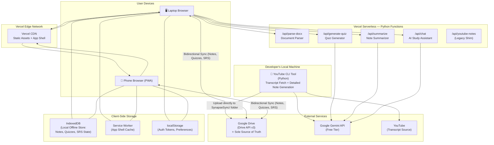
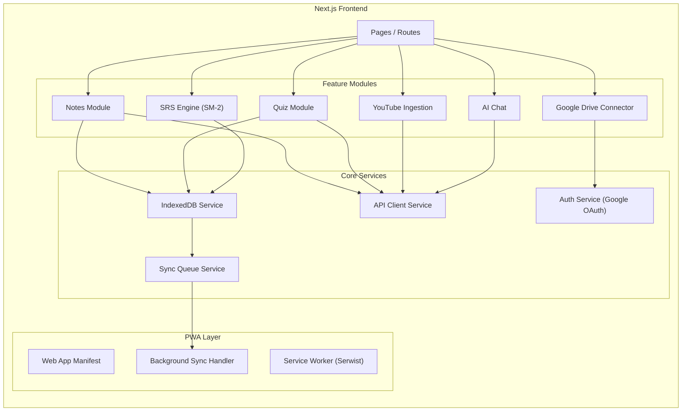
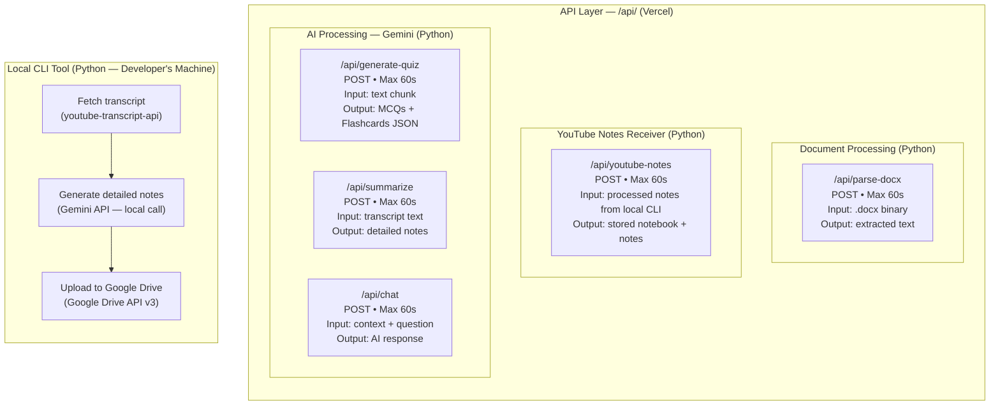
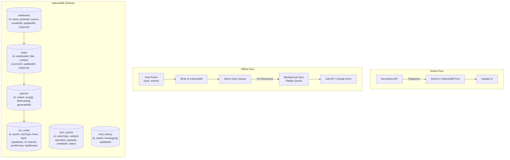
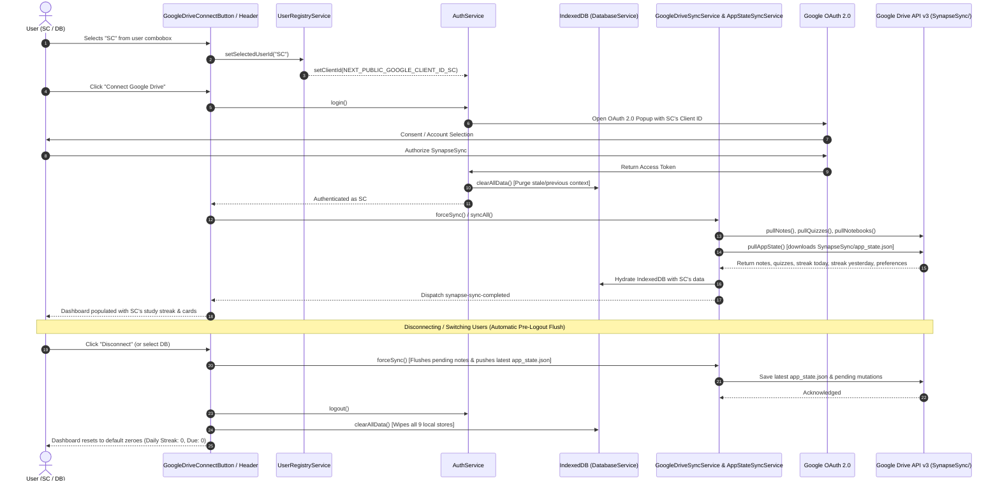
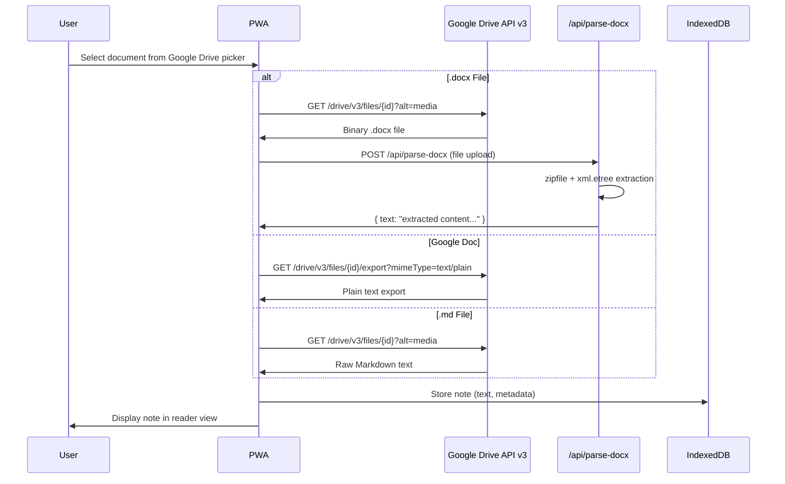
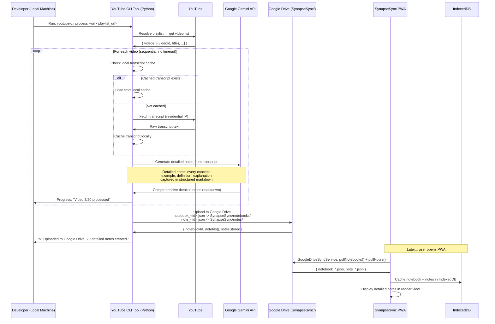
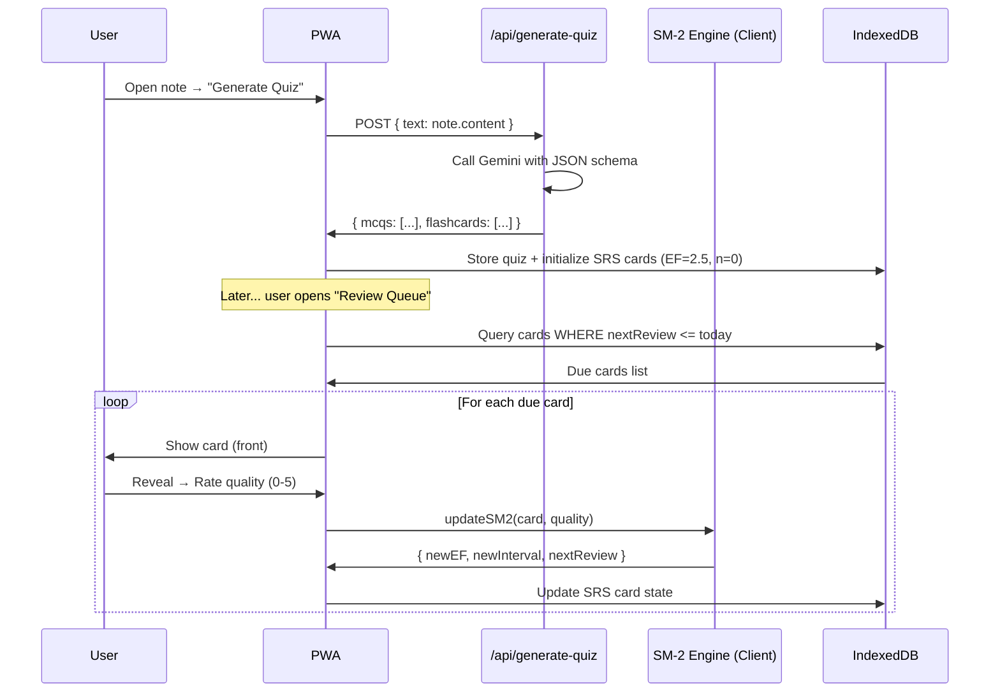
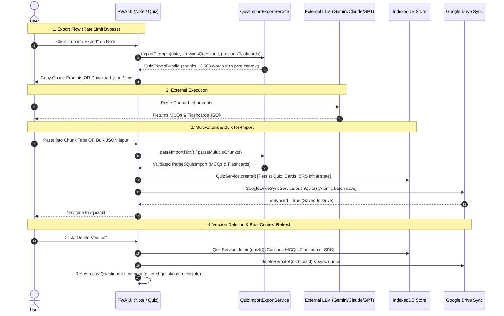

# SynapseSync — System Architecture Document

> **Version:** 1.1  
> **Date:** 2026-10-19  
> **Status:** Draft  

---

## 1. Architecture Overview

SynapseSync follows an **offline-first, client-heavy architecture** where the browser (PWA) is the primary runtime, Vercel Python serverless functions serve as lightweight stateless processing endpoints, and a **local Python CLI tool** handles YouTube transcript fetching and detailed note generation on the developer's machine.



---

## 2. Architectural Principles

| Principle                    | Rationale                                                                |
|:-----------------------------|:-------------------------------------------------------------------------|
| **Offline-First & Cloud Source of Truth** | IndexedDB serves as fast offline local DB; Google Drive is the sole cloud source of truth across devices (no server note storage) |
| **Client-Heavy / Server-Thin** | Vercel free tier has strict limits; minimize server work                |
| **Stateless Backend**        | Serverless functions have no persistent memory or note storage between invocations |
| **Micro-Request Pattern**    | Every API call must complete within 60 seconds; one unit of work per call|
| **Progressive Enhancement**  | Core features work offline; AI features enhance when online              |

---

## 3. Component Architecture

### 3.1 Frontend: Next.js (React) PWA

The frontend is a **Next.js application** deployed to Vercel as static/SSR pages. It handles all user interaction, state management, and offline capabilities.



#### Key Frontend Responsibilities

| Responsibility               | Implementation                                                          |
|:-----------------------------|:------------------------------------------------------------------------|
| Authentication               | Google OAuth 2.0 flow; tokens in `localStorage`                        |
| Google Drive file browsing   | Direct calls to Google Drive API v3 from browser (delegated auth)       |
| Note rendering               | Parse Markdown/extracted text; render with `react-markdown`             |
| Quiz taking & scoring        | Entirely client-side; results stored in IndexedDB                       |
| SM-2 algorithm execution     | Pure client-side computation — no server roundtrip needed               |
| Offline data management      | IndexedDB as primary store; sync queue for pending operations           |
| YouTube playlist orchestration | Handled by local Python CLI tool; PWA displays results after push to server |
| YouTube note viewing          | PWA fetches processed notes from server; displays in reader view           |

### 3.2 Backend: Python Serverless Functions + Local CLI Tool

The backend uses **Python serverless functions** on Vercel for AI processing, document parsing, and receiving YouTube notes. YouTube transcript fetching and detailed note generation run on the **developer's local machine** via a Python CLI tool, completely eliminating cloud IP blocking and serverless timeout constraints.

> [!IMPORTANT]
> **Why local processing for YouTube?** YouTube aggressively blocks cloud/datacenter IPs from scraping transcripts. By running the transcript fetch on a local machine (residential IP), blocking is eliminated entirely. Local processing also removes the 60-second Vercel timeout constraint, allowing Gemini to generate **detailed, comprehensive notes** without rushing. The final processed notes are pushed to a Vercel API endpoint for the PWA to consume.

Each serverless function is a **micro-scoped, stateless endpoint** that performs one focused task and returns structured JSON.



#### Endpoint Specifications (Vercel)

| Endpoint              | Runtime   | Method | Input                                            | Output                          | Gemini? | Max Time |
|:----------------------|:----------|:-------|:-------------------------------------------------|:--------------------------------|:--------|:---------|
| `/api/parse-docx`     | Python    | POST   | `.docx` file (multipart)                         | `{ text: string }`             | No      | ~5s      |
| `/api/youtube-notes`  | Python    | POST   | `{ notebook, notes[] }` (legacy compatibility)   | `{ notebookId, noteIds[] }`    | No      | ~10s     |
| `/api/generate-quiz`  | Python / Next.js | POST   | `{ text, difficulty?, mcqCount?, flashcardCount?, previousContext?, chunkIndex?, totalChunks?, sessionId?, exportOnly?, mode? }` | Quiz output: `{ mcqs, flashcards, metadata }`<br/>Export output: `{ mode, totalChunks, chunkWords, chunks: [{ chunkIndex, wordCount, prompt }] }` | Yes (multi-key failover; bypasses Gemini if exportOnly) | Layered: 360s SDK / 20m Node / 22m Client |
| `/api/summarize`      | Python    | POST   | `{ text: string }`                               | `{ notes: string }`            | Yes     | ~15s     |
| `/api/chat`           | Python    | POST   | `{ context, question, history }`                 | `{ answer: string }`           | Yes     | ~10s     |

#### Quiz Generation Timeout & Telemetry Architecture

1. **Layered Timeout Hierarchy:**
   - **Frontend Client (`ApiClient`):** Configured with a default timeout of `1,320,000 ms` (22 minutes).
   - **Node.js Subprocess (`route.ts`):** Spawns `api/generate_quiz.py` with an execution budget of `1,200,000 ms` (20 minutes) using `detached: true`. On timeout or client abort, the child process group (`-child.pid`) is terminated with `SIGKILL` to prevent orphan Python background processes.
   - **Gemini SDK (`gemini_service.py`):** Configured with `_DEFAULT_REQUEST_TIMEOUT = 360.0` (6 minutes per individual request). This ensures individual chunk calls have sufficient time to return while failing fast enough for Python's retry and backup key rotation loops to resolve well within Node's execution budget.

2. **Runtime Telemetry & Observability:**
   - Tracks `total_calls`, `successful_calls`, `timed_out_calls`, `retry_calls`, `backup_key_calls`, `backup_failovers`, and active key masking.
   - Emits formatted chunk progress updates to the server console:
     `[Quiz Generator] Chunk 1/13 completed in 203.3s (Gemini calls: 1, timed out: 0, backup key calls: 0)`
   - Logs an end-of-run banner detailing overall API usage and issues a warning if only a single Gemini API key is configured.

#### Local CLI Tool Specifications

| Operation               | Library/Tool                  | Input                           | Output                                | Gemini? | Timeout  |
|:------------------------|:------------------------------|:--------------------------------|:--------------------------------------|:--------|:---------|
| Fetch transcript        | `youtube-transcript-api` (Python) | YouTube video URL              | Raw transcript text                   | No      | None (local) |
| Resolve playlist        | `youtube-transcript-api` / HTTP | YouTube playlist URL            | List of `{ videoId, title, url }`     | No      | None (local) |
| Generate detailed notes | `google-genai` (Python)       | Raw transcript text             | Detailed markdown notes               | Yes     | None (local) |
| Upload to Google Drive  | `GoogleDrivePusher` / Drive API v3 | Notebook + notes payload        | Uploads to `SynapseSync/notebooks` & `SynapseSync/notes` | No | None (local) |

> [!NOTE]
> **Manual paste fallback:** The PWA still provides a text area for users to manually paste a transcript for individual videos not processed via the local CLI. The pasted text is sent to `/api/summarize` for server-side AI processing.

### 3.3 Offline-First Data Layer



---

## 4. Authentication & Multi-User Context Architecture

SynapseSync leverages Google Drive authentication as its primary user identity and storage boundary. Multiple pre-registered users (e.g. `SC`, `DB`) can use the same application instance. Selecting a user from the combobox dynamically configures the corresponding OAuth Client ID. When authenticating, all remote state (notes, quizzes, flashcards, chat, streak today, streak yesterday, and cards due) is pulled from that user's Google Drive. 

While online, the app automatically synchronizes via periodic timers (every 5 min), network reconnection events (`online`), and tab visibility changes (`visibilitychange`). Furthermore, **when logging out or switching users, the application automatically triggers a pre-logout sync (`forceSync()`) before purging the local IndexedDB stores**, guaranteeing that all latest study streaks, cards due, and notes are committed to Google Drive without requiring manual user intervention.

### 4.1 Google Drive Sync Architecture & Storage Hierarchy

Google Drive serves as the central cloud store for cross-device synchronization. Files are arranged inside a top-level dedicated folder:

```
Google Drive: SynapseSync/
├── app_state.json                 # Global snapshot (streaks today/yesterday, cards due, preferences)
├── notebooks/
│   └── notebook_<id>.json         # Notebook entities including parentId for hierarchical folders
├── notes/
│   └── note_<id>.json             # Individual note Markdown, wordCount, tags, and timestamps
├── quizzes/
│   └── quiz_<quizId>.json         # Full quiz bundle: { quiz, mcqCards, flashcards, srsCards }
└── chats/
    └── chat_<noteId>.json         # Scoped AI study assistant chat history
```

#### Sync Lifecycle & Deletion Propagation
1. **Hierarchical Subfolders**: Notebooks maintain `parentId` referencing their parent folder. Both `pushNotebook` and `pullNotebooks` serialize this field, maintaining folder trees seamlessly across devices.
2. **Note Deletions**: Deleting a note in the UI writes a `delete` mutation to `sync_queue`. During the normal sync cycle, `GoogleDriveSyncService._replayQueueEntries` triggers `deleteRemoteNote(noteId)`, removing `note_<id>.json` and `chat_<id>.json` from Google Drive.
3. **MCQ & Flashcard Deletions**: Individual questions deleted in the quiz view cascade to remove local SRS tracking records and enqueue a quiz update. During normal sync, `pushQuiz(quizId)` replaces the remote bundle `quiz_<quizId>.json` without the deleted cards. When other devices pull, `_saveImportedQuizPayload` reconciles local cards and prunes cards removed from Google Drive.
4. **Non-Blocking Normal Sync**: Operations do not block user interactions with synchronous remote calls; mutations are recorded locally in IndexedDB and replayed naturally during background sync.
5. **Quiz Sync Lifecycle & Status Verification**:
   - `Quiz` entities track `isSynced: boolean`. Newly created quizzes initialize with `isSynced = false`.
   - `GoogleDriveSyncService.pushQuiz()` updates local IndexedDB to `isSynced = true` upon upload.
   - `_pushUnsyncedQuizzes()` filters `allQuizzes.filter(q => !q.isSynced)` with per-item error handling, ensuring already-synced quizzes are not repeatedly re-uploaded and touched.
   - The UI displays dynamic sync indicators: `☁️ Saved to Drive` (when synced), a clickable `☁️ Sync to Drive` / `⏳ Syncing...` action (when local and Drive connected), and `💾 Local Workspace` (when disconnected).
6. **In-Flight Concurrency Control & Mutex Locking**:
   - `GoogleDriveApiClient._activeSaves` maps in-flight save promises by `${parentFolderId}:${fileName}`. Concurrent saves share the same in-flight promise rather than generating duplicate files.
   - `GoogleDriveSyncService._activeQuizPushes` maps in-flight quiz push operations by `quizId`.
   - `SyncManager.forceSync()` uses an `_isProcessing` guard to prevent overlapping full sync cycles.
7. **Self-Healing Duplicate Detection & Purging**:
   - Google Drive's API permits multiple files with identical names due to eventual consistency search delays.
   - In `GoogleDriveApiClient.saveFile()`, if `findAllFilesByName()` finds more than one file, it updates the primary file and deletes extra duplicates automatically.
   - In `GoogleDriveSyncService.pullQuizzes()`, seen filenames are tracked, and any duplicate quiz JSON files are purged automatically from Google Drive.



> [!IMPORTANT]
> **No tokens are ever sent to or stored on the Vercel backend.** The browser communicates directly with Google Drive API using delegated permissions. The Python serverless functions never need Google Drive access — the browser downloads file content and sends it to `/api/parse-docx`. Users never need to manually force sync before logging out because the client performs an automatic pre-logout flush before wiping local IndexedDB stores.

---

## 5. Data Flow Diagrams

### 5.1 Google Drive → Notes Flow



### 5.2 YouTube → Notes Flow (Local-First Pipeline)



### 5.3 Quiz Generation & SRS Flow



### 5.4 Offline Quiz Prompt Export, Multi-Chunk Import & Version Deletion Flow

To support offline workflows and eliminate free-tier API rate limit issues on large study notes, quizzes can be exported in chunked prompt bundles, generated in any external LLM, and re-imported seamlessly.



---

## 6. Project Structure

```
synapse-sync/
├── api/                              # Vercel Python Serverless Functions
│   ├── parse_docx.py                 # .docx text extraction
│   ├── generate_quiz.py              # Gemini quiz generation
│   ├── summarize.py                  # Gemini note summarization (for manual paste fallback)
│   ├── chat.py                       # Gemini study assistant
│   ├── youtube_notes.py              # Legacy endpoint shim
│   └── requirements.txt              # Python dependencies
│
├── tools/                            # Local CLI Tools (run on developer machine)
│   └── youtube_cli/                  # YouTube transcript + note generation CLI
│       ├── __init__.py
│       ├── main.py                   # CLI entry point
│       ├── transcript_fetcher.py     # Fetches transcripts via youtube-transcript-api
│       ├── playlist_resolver.py      # Resolves playlist URLs to video lists
│       ├── note_generator.py         # Generates detailed notes via Gemini
│       ├── google_drive_pusher.py    # Uploads processed notes & notebooks to Google Drive
│       ├── server_pusher.py          # Legacy server pusher adapter
│       ├── transcript_cache.py       # Local file-based transcript cache
│       ├── config.py                 # CLI configuration constants
│       └── requirements.txt          # Python dependencies for CLI tool
│
├── src/                              # Next.js Frontend Source
│   ├── app/                          # App Router pages
│   │   ├── layout.tsx                # Root layout + PWA meta
│   │   ├── page.tsx                  # Dashboard / Home
│   │   ├── notes/
│   │   │   ├── page.tsx              # Notes listing
│   │   │   └── [id]/page.tsx         # Note reader view
│   │   ├── quiz/
│   │   │   ├── page.tsx              # Quiz selection
│   │   │   └── [id]/page.tsx         # Quiz taking interface
│   │   ├── review/
│   │   │   └── page.tsx              # SRS daily review queue
│   │   ├── youtube/
│   │   │   └── page.tsx              # YouTube study hub (synced with Google Drive)
│   │   ├── chat/
│   │   │   └── page.tsx              # AI study assistant
│   │   └── settings/
│   │       └── page.tsx              # Settings & Google Drive connection
│   │
│   ├── components/                   # Reusable UI Components
│   │   ├── layout/
│   │   │   ├── Sidebar.tsx
│   │   │   ├── BottomNav.tsx         # Mobile navigation
│   │   │   └── Header.tsx
│   │   ├── notes/
│   │   │   ├── NoteCard.tsx
│   │   │   ├── NoteReader.tsx
│   │   │   └── GoogleDrivePicker.tsx
│   │   ├── quiz/
│   │   │   ├── MCQCard.tsx
│   │   │   ├── FlashCard.tsx
│   │   │   ├── QuizResults.tsx
│   │   │   ├── QuizImportExportModal.tsx # Offline prompt export & import dialog
│   │   │   ├── QuizExportTab.tsx         # Chunk selector, prompt view & downloads
│   │   │   └── QuizImportTab.tsx         # Per-chunk tabs & bulk JSON import view
│   │   ├── youtube/
│   │   │   ├── YouTubeNotesViewer.tsx # Displays notes generated by local CLI
│   │   │   └── TranscriptPaster.tsx   # Manual paste fallback UI
│   │   ├── review/
│   │   │   ├── ReviewCard.tsx
│   │   │   └── ReviewStats.tsx
│   │   └── common/
│   │       ├── ProgressBar.tsx
│   │       ├── SearchBar.tsx
│   │       └── ThemeToggle.tsx
│   │
│   ├── lib/                          # Core Libraries
│   │   ├── db/
│   │   │   ├── indexeddb.ts          # IndexedDB wrapper (idb)
│   │   │   ├── schema.ts            # Database schema definitions
│   │   │   └── sync.ts              # Sync queue management
│   │   ├── services/
│   │   │   └── quiz_import_export_service.ts # Prompt chunking, markdown & import parsing
│   │   ├── srs/
│   │   │   └── sm2.ts               # SM-2 algorithm implementation
│   │   ├── auth/
│   │   │   ├── google_auth_config.ts # Google OAuth 2.0 configuration
│   │   │   └── auth_service.ts       # Auth state & token manager
│   │   ├── api/
│   │   │   └── client.ts            # API client with retry logic
│   │   └── utils/
│   │       ├── markdown.ts           # Markdown rendering helpers
│   │       └── youtube.ts            # YouTube URL parsing
│   │
│   └── styles/
│       └── globals.css               # Design system tokens + global styles
│
├── public/
│   ├── manifest.json                 # PWA manifest
│   ├── sw.js                         # Service Worker
│   ├── icons/                        # PWA icons (multiple sizes)
│   └── offline.html                  # Offline fallback page
│
├── vercel.json                       # Vercel deployment configuration
├── next.config.js                    # Next.js configuration
├── package.json
├── tsconfig.json
└── documentation/
    ├── prompts/
    │   └── coding_standards.md
    └── design/
        └── high_level/
            ├── 01_product_requirements.md
            ├── 02_system_architecture.md
            ├── 03_data_models.md
            ├── 04_api_specifications.md
            ├── 05_deployment_guide.md
            └── 06_design_overview.md
```

---

## 7. Technology Stack Summary

| Layer                | Technology                  | Justification                                              |
|:---------------------|:----------------------------|:-----------------------------------------------------------|
| **Frontend Framework** | Next.js 16.4.2 (App Router) | SSR + static generation; native Vercel support             |
| **UI Library**       | React 19.3.1                | Component-based; modern React 19 architecture              |
| **Styling**          | Vanilla CSS (custom properties) | Maximum control; no build-time dependency              |
| **PWA Tooling**      | Serwist 9.5.13 (`@serwist/next`) | Service Worker management; precaching                    |
| **Offline Storage**  | IndexedDB via `idb` 8.0.4   | Structured client-side storage; large capacity             |
| **Auth Library**     | Google OAuth 2.0 with Google Drive API v3 | Client-side OAuth 2.0 token flow; direct Drive v3 REST calls |
| **Backend Runtime (AI/Parsing)** | Python 3.13 on Vercel | User requirement; Gemini SDK + docx parsing              |
| **Local CLI Tool (YouTube)** | Python 3.13 (local machine, `uv pip`) | Transcript fetch + detailed note generation; residential IP avoids blocking |
| **Doc Parsing**      | Python stdlib (`zipfile` + `xml`) | Zero dependencies; fast; reliable                    |
| **YouTube Transcripts** | `youtube-transcript-api` 1.2.4 (Python, local) | Runs locally; no cloud IP blocking; no timeout constraints |
| **AI Model & SDK**   | Google Gemini (Flash) via `google-genai` 2.25.0 | Modern Google GenAI SDK; free tier; structured output; fast responses; used both locally (notes) and on Vercel (quiz/chat) |
| **Deployment**       | Vercel (Hobby tier)         | Free; auto-deploy from Git; edge CDN                       |

---

## 8. Security Considerations

| Concern                      | Mitigation                                                           |
|:-----------------------------|:---------------------------------------------------------------------|
| OAuth token leakage           | PKCE flow (no client secret); tokens in `localStorage` with expiry  |
| XSS on rendered notes         | Sanitize HTML output from Markdown parser; CSP headers              |
| API endpoint abuse             | Rate limiting via Vercel Edge Middleware; CORS whitelist             |
| Data in transit                | HTTPS enforced by Vercel; all API calls over TLS                    |
| User data privacy              | No server-side storage; notes processed transiently in functions    |
| Gemini data policy             | Free tier: inputs may train models; no PII in study content         |

---

## 9. Scalability & Future Considerations

| Consideration                | Current (v1)                | Future (v2+)                              |
|:-----------------------------|:----------------------------|:------------------------------------------|
| Storage                      | IndexedDB (per-device)      | Supabase / Vercel KV for cross-device sync|
| Auth state                   | Browser localStorage        | Lightweight DB for multi-device sessions  |
| AI model                     | Gemini Free (Flash)         | Gemini Pro / paid tier for heavier tasks  |
| Hosting                      | Vercel Hobby                | Vercel Pro for longer timeouts            |
| Collaboration                | Not supported               | Real-time sync via WebSockets             |
| Mobile                       | PWA                         | React Native or Capacitor wrapper         |
