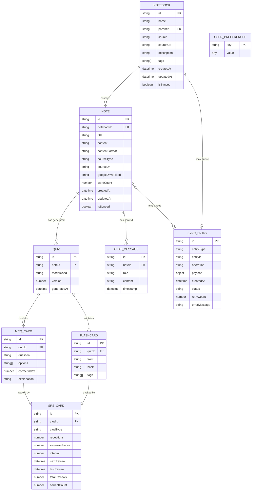

# SynapseSync — Data Models & Schema Design

> **Version:** 1.1  
> **Date:** 2026-10-19  
> **Status:** Draft  

---

## 1. Overview

SynapseSync uses **IndexedDB** as the primary client-side offline data store and **Google Drive** as the sole source of truth across devices. There is no server-side database or server-side note storage — all persistent state is owned by the user and lives in their dedicated Google Drive directory (`SynapseSync/`), while IndexedDB provides instant local access and offline capability. This document defines every entity, its fields, relationships, and indexing strategy.

The IndexedDB wrapper library `idb` provides a Promise-based API over the native IndexedDB interface.

---

## 2. Entity Relationship Diagram



---

## 3. Detailed Schema Definitions

### 3.1 Notebook

Represents a collection of related notes (e.g., a course, a YouTube playlist, a subject).

```typescript
interface Notebook {
  /** UUID v4 */
  id: string;
  
  /** Display name (e.g., "Stanford CS229 - Machine Learning") */
  name: string;
  
  /** Origin of the notebook */
  source: 'google_drive' | 'youtube_playlist' | 'manual';
  
  /** Parent folder identifier for nested subfolder organization */
  parentId?: string | null;
  
  /** Original URL (playlist URL or Google Drive folder path) */
  sourceUrl?: string;
  
  /** Short description */
  description?: string;
  
  /** User-assigned tags for filtering */
  tags: string[];
  
  /** ISO 8601 timestamps */
  createdAt: string;
  updatedAt: string;
  
  /** Whether all local changes have been synced */
  isSynced: boolean;
}
```

**IndexedDB Indexes:**
| Index Name     | Key Path    | Unique | Purpose                      |
|:---------------|:------------|:-------|:-----------------------------|
| `by-source`    | `source`    | No     | Filter notebooks by origin   |
| `by-updated`   | `updatedAt` | No     | Sort by recently modified    |
| `by-parent`    | `parentId`  | No     | Query subfolders by parent   |

---

### 3.2 Note

A single study note — either imported from Google Drive, generated from a YouTube transcript, or manually created.

```typescript
interface Note {
  /** UUID v4 */
  id: string;
  
  /** FK → Notebook.id */
  notebookId: string;
  
  /** Note title (video title, filename, or user-provided) */
  title: string;
  
  /** Full text content of the note */
  content: string;
  
  /** Format of the content field */
  contentFormat: 'markdown' | 'plaintext';
  
  /** How this note was created */
  sourceType: 'gdrive_docx' | 'gdrive_md' | 'gdrive_doc' | 'youtube_transcript' | 'manual';
  
  /** Original source URL (YouTube video URL, Google Drive file URL) */
  sourceUrl?: string;
  
  /** Google Drive file ID for sync-back */
  googleDriveFileId?: string;
  
  /** Computed word count for display */
  wordCount: number;
  
  /** ISO 8601 timestamps */
  createdAt: string;
  updatedAt: string;
  
  /** Sync status */
  isSynced: boolean;
}
```

**IndexedDB Indexes:**
| Index Name        | Key Path      | Unique | Purpose                           |
|:------------------|:--------------|:-------|:----------------------------------|
| `by-notebook`     | `notebookId`  | No     | List notes within a notebook      |
| `by-source-type`  | `sourceType`  | No     | Filter by origin                  |
| `by-updated`      | `updatedAt`   | No     | Sort by recently modified         |
| `by-title`        | `title`       | No     | Alphabetical listing              |

> [!NOTE]
> **Full-text search** is not natively supported by IndexedDB. We implement it by iterating over notes and using `String.prototype.includes()` or a lightweight library like `flexsearch` that maintains its own in-memory index built from IndexedDB data on app startup.

---

### 3.3 Quiz

A generated quiz associated with a specific note. Multiple quiz versions can exist per note (re-rolls).

```typescript
interface Quiz {
  /** UUID v4 */
  id: string;
  
  /** FK → Note.id */
  noteId: string;
  
  /** Which Gemini model generated this quiz, or 'manual-import' */
  modelUsed: string;
  
  /** Version number (increments on re-roll or manual import) */
  version: number;
  
  /** When this quiz was generated */
  generatedAt: string;

  /** Synchronization status with Google Drive */
  isSynced?: boolean;
}
```

**Sync Lifecycle & Version Deletion:**
- When created locally via `QuizService.create()`, `isSynced` is initialized to `false`.
- When successfully pushed to Google Drive via `GoogleDriveSyncService.pushQuiz()`, `isSynced` is updated to `true` in IndexedDB.
- When imported/pulled from Google Drive via `GoogleDriveSyncService.pullQuizzes()`, `isSynced` is set to `true`.
- **Entire Version Deletion**: Deleting a quiz version via `QuizService.delete(quizId)` cascades deletion across all associated `MCQCard`, `Flashcard`, and `SRSCard` entities in IndexedDB, and enqueues a `'delete'` operation in `SyncQueueService` to delete remote `quiz_<quizId>.json` from Google Drive via `GoogleDriveSyncService.deleteRemoteQuiz()`. Deleting a version frees its questions from the dynamic past questions exclusion context for subsequent quiz generation or prompt export.
- The UI reflects this state dynamically:
  - `isSynced === true`: Displays `☁️ Saved to Drive`.
  - `isSynced === false` & connected: Displays interactive `☁️ Sync to Drive` / `⏳ Syncing...` action.
  - Disconnected: Displays `💾 Local Workspace`.

**IndexedDB Indexes:**
| Index Name      | Key Path   | Unique | Purpose                         |
|:----------------|:-----------|:-------|:--------------------------------|
| `by-note`       | `noteId`   | No     | Find all quizzes for a note     |
| `by-generated`  | `generatedAt` | No  | Sort by creation date           |

---

### 3.4 MCQ Card

A single multiple-choice question within a quiz.

```typescript
interface MCQCard {
  /** UUID v4 */
  id: string;
  
  /** FK → Quiz.id */
  quizId: string;
  
  /** The question text */
  question: string;
  
  /** Array of 4 option strings */
  options: [string, string, string, string];
  
  /** Index (0-3) of the correct option */
  correctIndex: number;
  
  /** Explanation of why the correct answer is correct */
  explanation: string;
}
```

**IndexedDB Indexes:**
| Index Name    | Key Path | Unique | Purpose                       |
|:--------------|:---------|:-------|:------------------------------|
| `by-quiz`     | `quizId` | No     | List all MCQs in a quiz       |

---

### 3.5 Flashcard

A single active-recall flashcard within a quiz.

```typescript
interface Flashcard {
  /** UUID v4 */
  id: string;
  
  /** FK → Quiz.id */
  quizId: string;
  
  /** Front of the card (question/prompt) */
  front: string;
  
  /** Back of the card (answer/explanation) */
  back: string;
  
  /** Optional tags for categorization */
  tags: string[];
}
```

**IndexedDB Indexes:**
| Index Name    | Key Path | Unique | Purpose                           |
|:--------------|:---------|:-------|:----------------------------------|
| `by-quiz`     | `quizId` | No     | List all flashcards in a quiz     |

---

### 3.6 SRS Card (Spaced Repetition State)

Tracks the SM-2 algorithm state for each MCQ or flashcard. One SRS card per MCQ/Flashcard.

```typescript
interface SRSCard {
  /** UUID v4 */
  id: string;
  
  /** FK → MCQCard.id or Flashcard.id */
  cardId: string;
  
  /** Discriminator for the source card type */
  cardType: 'mcq' | 'flashcard';
  
  /**
   * SM-2 Parameters
   */
  
  /** Number of consecutive successful recalls (resets to 0 on failure) */
  repetitions: number;
  
  /** Easiness Factor — starts at 2.5, minimum 1.3 */
  easinessFactor: number;
  
  /** Current inter-repetition interval in days */
  interval: number;
  
  /** ISO 8601 — when this card is next due for review */
  nextReview: string;
  
  /** ISO 8601 — when this card was last reviewed */
  lastReview: string | null;
  
  /**
   * Analytics
   */
  
  /** Total number of times this card has been reviewed */
  totalReviews: number;
  
  /** Number of successful recalls (quality >= 3) */
  correctCount: number;
}
```

**IndexedDB Indexes:**
| Index Name         | Key Path      | Unique | Purpose                                   |
|:-------------------|:--------------|:-------|:------------------------------------------|
| `by-card`          | `cardId`      | Yes    | Look up SRS state for a specific card     |
| `by-next-review`   | `nextReview`  | No     | Query all cards due on or before today    |
| `by-card-type`     | `cardType`    | No     | Filter MCQs vs flashcards                 |

---

### 3.7 Chat Message

Stores the AI study assistant conversation history per note.

```typescript
interface ChatMessage {
  /** UUID v4 */
  id: string;
  
  /** FK → Note.id — conversation scoped to a note */
  noteId: string;
  
  /** Who sent this message */
  role: 'user' | 'assistant';
  
  /** Message content (Markdown) */
  content: string;
  
  /** ISO 8601 */
  timestamp: string;
}
```

**IndexedDB Indexes:**
| Index Name       | Key Path    | Unique | Purpose                            |
|:-----------------|:------------|:-------|:-----------------------------------|
| `by-note`        | `noteId`    | No     | Load conversation for a note       |
| `by-timestamp`   | `timestamp` | No     | Order messages chronologically     |

---

### 3.8 Sync Entry (Sync Queue)

Tracks operations that were performed offline and need to be replayed when connectivity returns.

```typescript
interface SyncEntry {
  /** UUID v4 */
  id: string;
  
  /** What type of entity was modified */
  entityType: 'notebook' | 'note' | 'quiz' | 'srs_card';
  
  /** The ID of the modified entity */
  entityId: string;
  
  /** What operation was performed */
  operation: 'create' | 'update' | 'delete';
  
  /** Serialized data to replay */
  payload: Record<string, unknown>;
  
  /** When the offline operation occurred */
  createdAt: string;
  
  /** Current sync status */
  status: 'pending' | 'in_progress' | 'completed' | 'failed';
  
  /** Number of sync attempts */
  retryCount: number;
  
  /** Last error message if sync failed */
  errorMessage?: string;
}
```

**IndexedDB Indexes:**
| Index Name       | Key Path    | Unique | Purpose                            |
|:-----------------|:------------|:-------|:-----------------------------------|
| `by-status`      | `status`    | No     | Find all pending operations        |
| `by-entity`      | `entityId`  | No     | Find all sync ops for an entity    |
| `by-created`     | `createdAt` | No     | Process in FIFO order              |

---

### 3.9 User Preferences

Simple key-value store for user settings.

```typescript
interface UserPreference {
  /** Setting key (e.g., "theme", "dailyGoal", "notificationEnabled") */
  key: string;
  
  /** Setting value (any serializable type) */
  value: string | number | boolean | object;
}
```

**Known Keys:**
| Key                    | Type      | Default    | Description                          |
|:-----------------------|:----------|:-----------|:-------------------------------------|
| `theme`                | `string`  | `'system'` | `'light'`, `'dark'`, or `'system'`  |
| `dailyCardGoal`        | `number`  | `20`       | Target flashcards per day            |
| `quizDifficulty`       | `string`  | `'medium'` | `'easy'`, `'medium'`, `'hard'`      |
| `googleDriveConnected` | `boolean` | `false`    | Whether Google Drive is linked       |
| `lastSyncTimestamp`    | `string`  | `null`     | ISO 8601 of last successful sync    |
| `pomodoroWorkMinutes`  | `number`  | `25`       | Pomodoro work interval duration      |
| `pomodoroBreakMinutes` | `number`  | `5`        | Pomodoro break interval duration     |
| `studyStreakDays`      | `number`  | `0`        | Cached current daily study streak    |
| `studyStreakYesterday` | `number`  | `0`        | Cached study streak as of yesterday  |
| `cardsDueToday`        | `number`  | `0`        | Cached cards due on current date     |

---

### 3.10 Pre-Registered User

Models client-side configured users with dedicated Google OAuth Client IDs.

```typescript
interface PreRegisteredUser {
  /** Identifier displayed in combobox (e.g. "SC", "DB") */
  id: string;

  /** Human-readable display label */
  name: string;

  /** Google Cloud OAuth 2.0 Web Client ID */
  clientId: string;
}
```

---

### 3.11 Application State Snapshot (Google Drive `app_state.json`)

Serialized and saved directly to the root `SynapseSync/` folder on Google Drive. Represents the complete learning context of a user across devices.

```typescript
interface AppStateStudyStats {
  cardsDueToday: number;
  studyStreakDays: number;
  studyStreakYesterday: number;
  lastReviewDate: string | null;
  totalReviewsCompleted: number;
  masteredCards: number;
}

interface AppStatePayload {
  version: number;
  updatedAt: string;
  userId?: string;
  studyStats: AppStateStudyStats;
  preferences: Record<string, unknown>;
  srsCards: SRSCard[];
  chatMessages: ChatMessage[];
}
```

**Google Drive Cloud Directory Structure:**
```
SynapseSync/
├── app_state.json                 # Global state, streaks, due cards, preferences, chat
├── notebooks/
│   └── notebook_<id>.json         # Notebook collections
├── notes/
│   └── note_<id>.json             # Study notes
└── quizzes/
    └── quiz_<id>.json             # Quizzes bundled with MCQs, flashcards, and SRS cards
```

---

## 4. SM-2 Algorithm Implementation

The SM-2 spaced repetition algorithm runs **entirely on the client**. No server interaction is needed.

### 4.1 Algorithm Pseudocode

```typescript
interface SM2Result {
  repetitions: number;
  easinessFactor: number;
  interval: number;
  nextReview: string; // ISO 8601 date
}

function calculateSM2(
  card: SRSCard,
  quality: number // 0-5 rating from user
): SM2Result {
  // Clamp quality to valid range
  const q = Math.max(0, Math.min(5, quality));
  
  let { repetitions, easinessFactor, interval } = card;
  
  // Update easiness factor
  easinessFactor = easinessFactor + (0.1 - (5 - q) * (0.08 + (5 - q) * 0.02));
  easinessFactor = Math.max(1.3, easinessFactor); // Floor at 1.3
  
  if (q < 3) {
    // Failed recall — reset
    repetitions = 0;
    interval = 1;
  } else {
    // Successful recall
    if (repetitions === 0) {
      interval = 1;
    } else if (repetitions === 1) {
      interval = 6;
    } else {
      interval = Math.round(interval * easinessFactor);
    }
    repetitions += 1;
  }
  
  // Calculate next review date
  const nextReview = new Date();
  nextReview.setDate(nextReview.getDate() + interval);
  
  return {
    repetitions,
    easinessFactor,
    interval,
    nextReview: nextReview.toISOString(),
  };
}
```

### 4.2 Quality Rating UI Mapping

| Rating | Label                | Color   | SM-2 Effect                                |
|:-------|:---------------------|:--------|:-------------------------------------------|
| 0      | Blackout             | 🔴 Red  | Reset to day 1; EF decreases significantly |
| 1      | Incorrect (remembered after) | 🟠 Orange | Reset to day 1; EF decreases      |
| 2      | Incorrect (seemed easy)      | 🟡 Yellow | Reset to day 1; EF decreases slightly |
| 3      | Correct (difficult)  | 🟢 Light Green | Continue; EF may decrease slightly  |
| 4      | Correct (hesitation)  | 🟢 Green | Continue; EF stable                      |
| 5      | Perfect              | 🔵 Blue  | Continue; EF increases                    |

---

## 5. Gemini API Response Schemas

### 5.1 Quiz Generation Schema

This JSON schema is passed to Gemini's structured output mode to guarantee clean responses.

```json
{
  "type": "object",
  "properties": {
    "mcqs": {
      "type": "array",
      "items": {
        "type": "object",
        "properties": {
          "question": { "type": "string" },
          "options": {
            "type": "array",
            "items": { "type": "string" },
            "minItems": 4,
            "maxItems": 4
          },
          "correctIndex": {
            "type": "integer",
            "minimum": 0,
            "maximum": 3
          },
          "explanation": { "type": "string" }
        },
        "required": ["question", "options", "correctIndex", "explanation"]
      },
      "minItems": 5,
      "maxItems": 5
    },
    "flashcards": {
      "type": "array",
      "items": {
        "type": "object",
        "properties": {
          "front": { "type": "string" },
          "back": { "type": "string" }
        },
        "required": ["front", "back"]
      },
      "minItems": 5,
      "maxItems": 5
    }
  },
  "required": ["mcqs", "flashcards"]
}
```

### 5.2 Detailed Note Generation Schema

Used by both the local CLI tool (for YouTube transcripts) and the `/api/summarize` endpoint. Instructs Gemini to generate **comprehensive, detailed notes** — not summaries.

```json
{
  "type": "object",
  "properties": {
    "title": { "type": "string" },
    "summary": {
      "type": "string",
      "description": "A brief 2-3 sentence executive summary of the content"
    },
    "keyPoints": {
      "type": "array",
      "items": { "type": "string" },
      "description": "Top 5-10 key takeaways from the content"
    },
    "markdownNotes": {
      "type": "string",
      "description": "Comprehensive, detailed notes in Markdown format. Must capture every concept, definition, example, analogy, formula, and explanation from the source material. Use headings, subheadings, bullet points, numbered lists, bold/italic emphasis, and code blocks where appropriate. The notes should be detailed enough that someone reading only these notes would have a thorough understanding of the topic without needing to watch the original video or read the original text."
    }
  },
  "required": ["title", "summary", "keyPoints", "markdownNotes"]
}
```

> [!IMPORTANT]
> The `markdownNotes` field is the primary output and must be **exhaustively detailed**. Gemini is instructed to act as a meticulous note-taker, not a summarizer. Every concept, example, definition, and explanation from the source material must be captured.

---

## 6. IndexedDB Database Initialization

```typescript
import { openDB, DBSchema } from 'idb';

interface SynapseSyncDB extends DBSchema {
  notebooks: {
    key: string;
    value: Notebook;
    indexes: {
      'by-source': string;
      'by-updated': string;
    };
  };
  notes: {
    key: string;
    value: Note;
    indexes: {
      'by-notebook': string;
      'by-source-type': string;
      'by-updated': string;
      'by-title': string;
    };
  };
  quizzes: {
    key: string;
    value: Quiz;
    indexes: {
      'by-note': string;
      'by-generated': string;
    };
  };
  mcq_cards: {
    key: string;
    value: MCQCard;
    indexes: {
      'by-quiz': string;
    };
  };
  flashcards: {
    key: string;
    value: Flashcard;
    indexes: {
      'by-quiz': string;
    };
  };
  srs_cards: {
    key: string;
    value: SRSCard;
    indexes: {
      'by-card': string;
      'by-next-review': string;
      'by-card-type': string;
    };
  };
  chat_messages: {
    key: string;
    value: ChatMessage;
    indexes: {
      'by-note': string;
      'by-timestamp': string;
    };
  };
  sync_queue: {
    key: string;
    value: SyncEntry;
    indexes: {
      'by-status': string;
      'by-entity': string;
      'by-created': string;
    };
  };
  preferences: {
    key: string;
    value: UserPreference;
  };
}

const DB_NAME = 'synapse-sync';
const DB_VERSION = 1;

async function initDB() {
  return openDB<SynapseSyncDB>(DB_NAME, DB_VERSION, {
    upgrade(db) {
      // Notebooks
      const notebookStore = db.createObjectStore('notebooks', { keyPath: 'id' });
      notebookStore.createIndex('by-source', 'source');
      notebookStore.createIndex('by-updated', 'updatedAt');

      // Notes
      const noteStore = db.createObjectStore('notes', { keyPath: 'id' });
      noteStore.createIndex('by-notebook', 'notebookId');
      noteStore.createIndex('by-source-type', 'sourceType');
      noteStore.createIndex('by-updated', 'updatedAt');
      noteStore.createIndex('by-title', 'title');

      // Quizzes
      const quizStore = db.createObjectStore('quizzes', { keyPath: 'id' });
      quizStore.createIndex('by-note', 'noteId');
      quizStore.createIndex('by-generated', 'generatedAt');

      // MCQ Cards
      const mcqStore = db.createObjectStore('mcq_cards', { keyPath: 'id' });
      mcqStore.createIndex('by-quiz', 'quizId');

      // Flashcards
      const flashcardStore = db.createObjectStore('flashcards', { keyPath: 'id' });
      flashcardStore.createIndex('by-quiz', 'quizId');

      // SRS Cards
      const srsStore = db.createObjectStore('srs_cards', { keyPath: 'id' });
      srsStore.createIndex('by-card', 'cardId', { unique: true });
      srsStore.createIndex('by-next-review', 'nextReview');
      srsStore.createIndex('by-card-type', 'cardType');

      // Chat Messages
      const chatStore = db.createObjectStore('chat_messages', { keyPath: 'id' });
      chatStore.createIndex('by-note', 'noteId');
      chatStore.createIndex('by-timestamp', 'timestamp');

      // Sync Queue
      const syncStore = db.createObjectStore('sync_queue', { keyPath: 'id' });
      syncStore.createIndex('by-status', 'status');
      syncStore.createIndex('by-entity', 'entityId');
      syncStore.createIndex('by-created', 'createdAt');

      // Preferences
      db.createObjectStore('preferences', { keyPath: 'key' });
    },
  });
}
```

---

## 7. Data Size Estimates

| Entity       | Avg. Size per Record | Estimated Records (Active User) | Total Size   |
|:-------------|:---------------------|:-------------------------------|:-------------|
| Notebook     | ~500 bytes           | 10-20                          | ~10 KB       |
| Note         | ~10 KB               | 100-500                        | ~5 MB        |
| Quiz         | ~200 bytes           | 100-500                        | ~100 KB      |
| MCQ Card     | ~1 KB                | 500-2,500                      | ~2.5 MB      |
| Flashcard    | ~500 bytes           | 500-2,500                      | ~1.25 MB     |
| SRS Card     | ~300 bytes           | 1,000-5,000                    | ~1.5 MB      |
| Chat Message | ~500 bytes           | 500-2,000                      | ~1 MB        |
| Sync Queue   | ~500 bytes           | 0-50 (transient)               | ~25 KB       |
| **Total**    |                      |                                | **~11 MB**   |

> [!TIP]
> IndexedDB typically supports **50 MB to several GB** of storage per origin depending on the browser and available disk space. Our estimated 11 MB is well within limits even on mobile devices.
