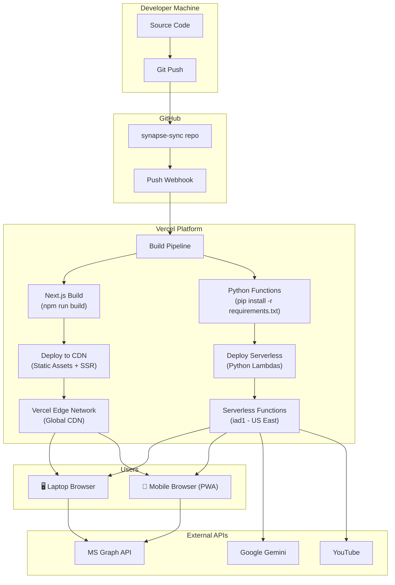
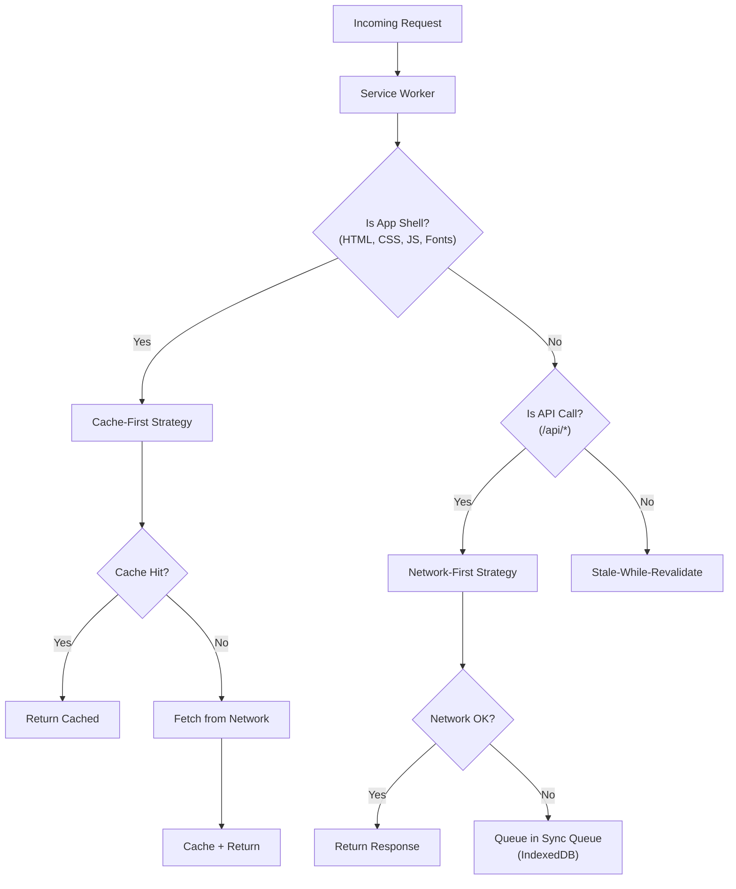

# SynapseSync — Deployment & Infrastructure Guide

> **Version:** 1.1  
> **Date:** 2026-10-19  
> **Status:** Draft  

---

## 1. Deployment Architecture Overview



---

## 2. Pre-Deployment Setup

### 2.1 External Service Registration

Before deploying, register the app with the following services:

#### Google AI Studio (Gemini API Key)

1. Go to [Google AI Studio](https://aistudio.google.com/)
2. Sign in with your Google account
3. Navigate to **Get API Key** → **Create API key**
4. Select or create a Google Cloud project (do **NOT** enable billing to stay on free tier)
5. Copy the API key → store securely

> [!CAUTION]
> If you enable billing on the Google Cloud project, you will be moved to a pay-as-you-go model and lose free tier access.

#### Microsoft Entra (Azure AD) App Registration

1. Go to [Microsoft Entra Admin Center](https://entra.microsoft.com/)
2. Navigate to **Identity** → **Applications** → **App Registrations** → **New Registration**
3. Configure:
   - **Name:** `SynapseSync`
   - **Supported account types:** "Accounts in any organizational directory and personal Microsoft accounts"
   - **Redirect URI:** Select **Single-page application (SPA)** and enter:
     - `https://synapse-sync.vercel.app` (production)
     - `http://localhost:3000` (development)
4. After registration, copy the **Application (client) ID**
5. Navigate to **API Permissions** → **Add a permission** → **Microsoft Graph** → **Delegated permissions**:
   - `Files.Read`
   - `Files.ReadWrite`
   - `User.Read`
6. Click **Grant admin consent** (if you are the admin)

> [!IMPORTANT]
> SPA registrations do **NOT** use client secrets. The PKCE flow handles security entirely through code verifier/challenge pairs.

---

### 2.2 Repository Structure for Vercel

```
synapse-sync/
├── api/                          # ← Vercel detects as Python serverless functions
│   ├── parse_docx.py
│   ├── youtube_notes.py          # Receives processed notes from local CLI
│   ├── generate_quiz.py
│   ├── summarize.py
│   ├── chat.py
│   └── requirements.txt         # ← Auto-installed by Vercel
│
├── tools/                        # ← Local CLI tools (NOT deployed to Vercel)
│   └── youtube_cli/
│       ├── main.py
│       ├── transcript_fetcher.py
│       ├── playlist_resolver.py
│       ├── note_generator.py
│       ├── server_pusher.py
│       ├── transcript_cache.py
│       ├── config.py
│       └── requirements.txt
│
├── src/                          # ← Next.js source
│   ├── app/
│   └── ...
│
├── public/
│   ├── manifest.json
│   └── ...
│
├── package.json
├── next.config.js
├── tsconfig.json
└── vercel.json
```

---

## 3. Vercel Deployment

### 3.1 Initial Setup

```bash
# 1. Install Vercel CLI
npm install -g vercel

# 2. Login to Vercel
vercel login

# 3. Link repository (run from project root)
vercel link

# 4. Set environment variables
vercel env add GEMINI_API_KEY production
vercel env add NEXT_PUBLIC_MSAL_CLIENT_ID production
vercel env add NEXT_PUBLIC_MSAL_REDIRECT_URI production
vercel env add NEXT_PUBLIC_API_URL production
vercel env add YOUTUBE_NOTES_API_KEY production
```

### 3.2 Environment Variables

| Variable                         | Value (Production)                           | Value (Development)                |
|:---------------------------------|:---------------------------------------------|:-----------------------------------|
| `GEMINI_API_KEY`                | `AIza...` (from Google AI Studio)            | Same                               |
| `NEXT_PUBLIC_MSAL_CLIENT_ID`   | `xxxxxxxx-xxxx-xxxx-xxxx-xxxxxxxxxxxx`       | Same                               |
| `NEXT_PUBLIC_MSAL_REDIRECT_URI`| `https://synapse-sync.vercel.app`            | `http://localhost:3000`            |
| `NEXT_PUBLIC_API_URL`          | `https://synapse-sync.vercel.app`            | `http://localhost:3000`            |
| `YOUTUBE_NOTES_API_KEY`        | `<shared-secret>`                            | Same                               |

### 3.3 Vercel Configuration File

```json
{
  "version": 2,
  "framework": "nextjs",
  "builds": [
    {
      "src": "api/*.py",
      "use": "@vercel/python"
    }
  ],
  "functions": {
    "api/youtube_notes.py": {
      "maxDuration": 60,
      "memory": 1024
    },
    "api/generate_quiz.py": {
      "maxDuration": 60,
      "memory": 1024
    },
    "api/summarize.py": {
      "maxDuration": 60,
      "memory": 1024
    },
    "api/chat.py": {
      "maxDuration": 60,
      "memory": 512
    },
    "api/parse_docx.py": {
      "maxDuration": 30,
      "memory": 512
    }
  },
  "headers": [
    {
      "source": "/api/(.*)",
      "headers": [
        { "key": "Access-Control-Allow-Origin", "value": "*" },
        { "key": "Access-Control-Allow-Methods", "value": "POST, GET, OPTIONS" },
        { "key": "Access-Control-Allow-Headers", "value": "Content-Type, Authorization" }
      ]
    },
    {
      "source": "/(.*)",
      "headers": [
        { "key": "X-Content-Type-Options", "value": "nosniff" },
        { "key": "X-Frame-Options", "value": "DENY" },
        { "key": "Referrer-Policy", "value": "strict-origin-when-cross-origin" }
      ]
    }
  ]
}
```

### 3.4 Deploy Commands

```bash
# Preview deployment (creates unique URL)
vercel

# Production deployment
vercel --prod

# Check deployment status
vercel ls
```

---

## 4. Local Development Setup

### 4.1 Prerequisites

| Tool     | Version  | Purpose                          |
|:---------|:---------|:---------------------------------|
| Node.js  | 18+      | Next.js runtime                  |
| Python   | 3.12+    | API function development         |
| npm      | 9+       | Package management               |

### 4.2 Setup Steps

```bash
# 1. Clone repository
git clone https://github.com/yourusername/synapse-sync.git
cd synapse-sync

# 2. Install Node.js dependencies
npm install

# 3. Activate the Python virtual environment
source ~/python_envs/p313_llm/bin/activate

# 4. Install Python dependencies for API functions
pip install -r api/requirements.txt

# 5. Install Python dependencies for local YouTube CLI tool
pip install -r tools/youtube_cli/requirements.txt

# 6. Create local environment file
cp .env.example .env.local
# Edit .env.local with your API keys

# 7. Run development server (Vercel CLI handles both Next.js and Python)
vercel dev
```

### 4.3 Local Environment File

```bash
# .env.local
GEMINI_API_KEY=your_gemini_api_key_here
NEXT_PUBLIC_MSAL_CLIENT_ID=your_azure_client_id_here
NEXT_PUBLIC_MSAL_REDIRECT_URI=http://localhost:3000
NEXT_PUBLIC_API_URL=http://localhost:3000
YOUTUBE_NOTES_API_KEY=your_shared_secret_here
```

### 4.4 Local YouTube CLI Tool Usage

```bash
# Activate the Python virtual environment
source ~/python_envs/p313_llm/bin/activate

# Process a single YouTube video
python -m tools.youtube_cli.main process --url "https://www.youtube.com/watch?v=jGwO_UgTS7I"

# Process a YouTube playlist
python -m tools.youtube_cli.main process --url "https://www.youtube.com/playlist?list=PLoROMvodv4rMiGQp3WXShtMGgzqpfVfbU"

# Push processed notes to the server
python -m tools.youtube_cli.main push --notebook-id <id> --server-url https://synapse-sync.vercel.app
```

> [!TIP]
> The local CLI tool uses your machine's residential IP to fetch YouTube transcripts, completely avoiding the cloud IP blocking issue that affects Vercel datacenter IPs.

---

## 5. PWA Configuration

### 5.1 Web App Manifest

```json
{
  "name": "SynapseSync - AI Study Companion",
  "short_name": "SynapseSync",
  "description": "Your AI-powered, offline-first study companion",
  "start_url": "/",
  "display": "standalone",
  "background_color": "#0a0a0f",
  "theme_color": "#6366f1",
  "orientation": "any",
  "categories": ["education", "productivity"],
  "icons": [
    { "src": "/icons/icon-72x72.png", "sizes": "72x72", "type": "image/png" },
    { "src": "/icons/icon-96x96.png", "sizes": "96x96", "type": "image/png" },
    { "src": "/icons/icon-128x128.png", "sizes": "128x128", "type": "image/png" },
    { "src": "/icons/icon-144x144.png", "sizes": "144x144", "type": "image/png" },
    { "src": "/icons/icon-152x152.png", "sizes": "152x152", "type": "image/png" },
    { "src": "/icons/icon-192x192.png", "sizes": "192x192", "type": "image/png" },
    { "src": "/icons/icon-384x384.png", "sizes": "384x384", "type": "image/png" },
    { "src": "/icons/icon-512x512.png", "sizes": "512x512", "type": "image/png", "purpose": "any maskable" }
  ]
}
```

### 5.2 Service Worker Strategy



---

## 6. CI/CD Pipeline

### 6.1 Automated Checks (GitHub Actions)

```yaml
# .github/workflows/ci.yml
name: CI

on:
  push:
    branches: [main, develop]
  pull_request:
    branches: [main]

jobs:
  lint-and-test:
    runs-on: ubuntu-latest
    steps:
      - uses: actions/checkout@v4
      
      - name: Setup Node.js
        uses: actions/setup-node@v4
        with:
          node-version: '18'
          cache: 'npm'
      
      - name: Install dependencies
        run: npm ci
      
      - name: Lint
        run: npm run lint
      
      - name: Type check
        run: npx tsc --noEmit
      
      - name: Run tests
        run: npm test
      
      - name: Build
        run: npm run build

  python-lint:
    runs-on: ubuntu-latest
    steps:
      - uses: actions/checkout@v4
      
      - name: Setup Python
        uses: actions/setup-python@v5
        with:
          python-version: '3.12'
      
      - name: Install dependencies
        run: pip install -r api/requirements.txt flake8
      
      - name: Lint Python
        run: flake8 api/ --max-line-length=120
```

### 6.2 Vercel Auto-Deploy

Vercel automatically deploys:
- **Production:** On push to `main` branch
- **Preview:** On push to any other branch or PR

---

## 7. Monitoring & Observability

### 7.1 Free-Tier Monitoring Options

| Tool                    | Purpose                             | Cost   |
|:------------------------|:------------------------------------|:-------|
| Vercel Analytics         | Web vitals, page load times        | Free (limited) |
| Vercel Function Logs     | Serverless function logs           | Free   |
| Google AI Studio Dashboard | Gemini API usage and quotas      | Free   |
| Browser DevTools         | IndexedDB inspection, SW debugging | Free   |

### 7.2 Key Metrics to Track

| Metric                          | Threshold        | Action if Exceeded                    |
|:--------------------------------|:-----------------|:--------------------------------------|
| Function execution time          | > 45 seconds     | Optimize or split request             |
| Gemini API errors (429)          | > 5% of requests | Increase client-side throttle delay   |
| YouTube transcript failures      | > 20% of requests| Investigate IP blocking; add proxy    |
| Monthly CPU time                 | > 3 hours        | Review caching strategy               |
| IndexedDB storage per user       | > 50 MB          | Add data pruning / archiving          |

---

## 8. Free Tier Budget Tracker

### 8.1 Monthly Usage Estimates (Active Personal Use)

| Resource                    | Estimate / Month       | Free Tier Limit    | Utilization |
|:----------------------------|:-----------------------|:-------------------|:------------|
| **Vercel Function Invocations** | ~5,000             | 1,000,000          | 0.5%        |
| **Vercel CPU Time**         | ~30 minutes            | 4 hours            | 12.5%       |
| **Gemini API Requests**     | ~1,000                 | ~1,500/day         | Well within |
| **Gemini Tokens**           | ~500K/month            | ~250K-1M/min       | Well within |
| **OneDrive API Calls**      | ~500                   | Throttle-based     | Well within |
| **Vercel Bandwidth**        | ~500 MB                | 100 GB             | 0.5%        |

> [!TIP]
> As a single-user personal study tool, you will use a tiny fraction of the available free tier resources. Aggressive client-side caching (IndexedDB) further reduces API calls since notes and quizzes are fetched once and stored locally.

---

## 9. Troubleshooting Guide

### 9.1 Common Issues

| Issue                                | Cause                          | Fix                                              |
|:-------------------------------------|:-------------------------------|:-------------------------------------------------|
| `504 Gateway Timeout`                | Function exceeds 60s           | Reduce payload size; split into micro-requests   |
| `429 Too Many Requests` from Gemini  | Rate limit exceeded            | Increase delay between requests; check quotas    |
| YouTube transcript returns empty     | Video has no captions          | Use manual paste fallback in PWA                  |
| OneDrive login fails                 | Redirect URI mismatch          | Verify redirect URI in Entra matches exactly      |
| PWA not installing                   | Missing manifest fields        | Verify all required PWA manifest fields present   |
| IndexedDB quota exceeded             | Too much cached data           | Implement data pruning for old notes/chats       |
| CORS errors on API calls             | Missing CORS headers           | Check `vercel.json` headers configuration         |
| Python function "module not found"   | Missing from `requirements.txt`| Add dependency to `api/requirements.txt`          |
| Local CLI fails to push to server    | Invalid API key or server URL  | Verify `YOUTUBE_NOTES_API_KEY` matches on both sides |

### 9.2 Useful Debug Commands

```bash
# Check Vercel function logs (production)
vercel logs --follow

# Check deployment status
vercel inspect <deployment-url>

# Test Python function locally
cd api && python -c "from transcript import handler; print('OK')"

# Check IndexedDB from browser console
const db = await indexedDB.open('synapse-sync');
console.log('DB version:', db.version);
```

---

## 10. Security Checklist

- [ ] `GEMINI_API_KEY` is set as a Vercel environment variable (NOT prefixed with `NEXT_PUBLIC_`)
- [ ] MSAL.js uses PKCE flow (no client secret)
- [ ] `vercel.json` includes security headers (`X-Content-Type-Options`, `X-Frame-Options`)
- [ ] CORS is restricted to known origins in production
- [ ] CSP headers prevent inline script injection
- [ ] No sensitive data logged in function output
- [ ] `.env.local` is in `.gitignore`
- [ ] User notes are processed transiently (never persisted server-side)
