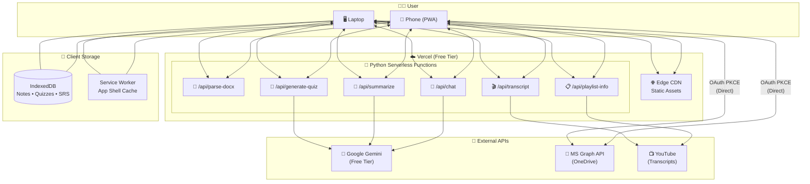
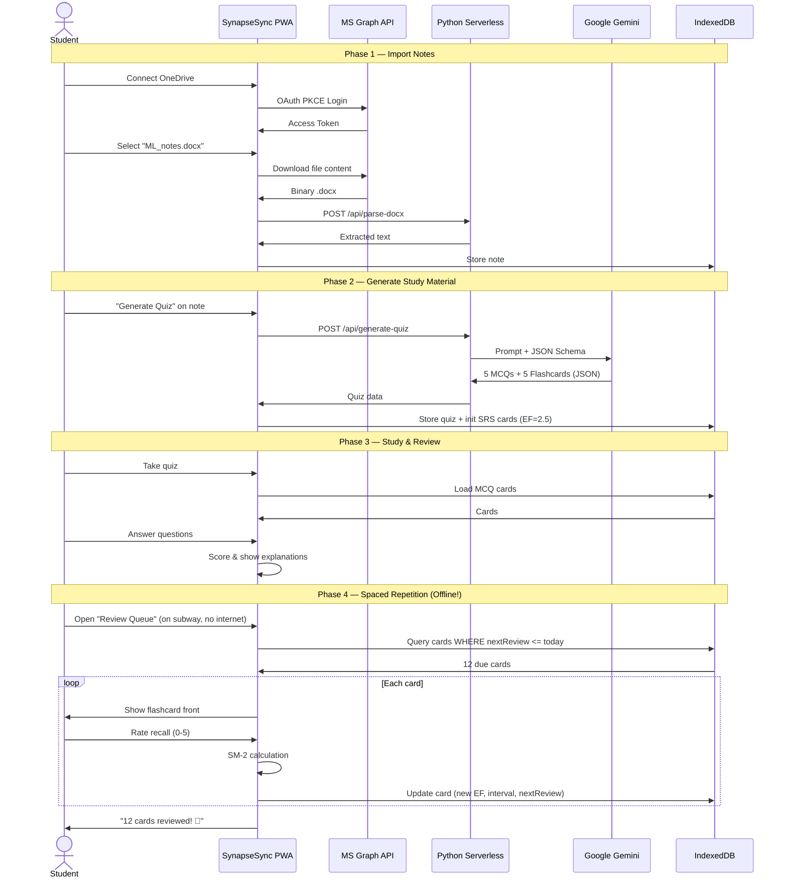
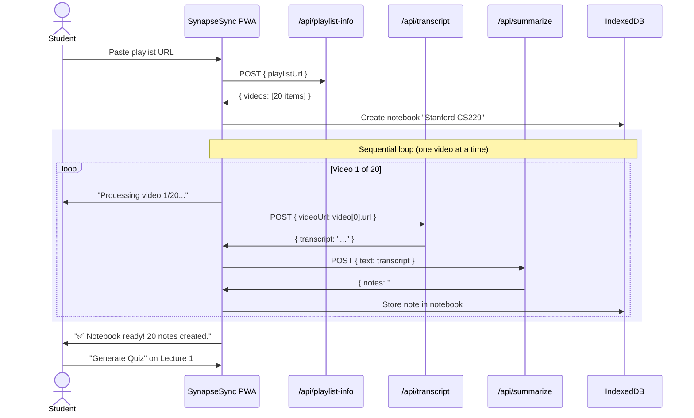
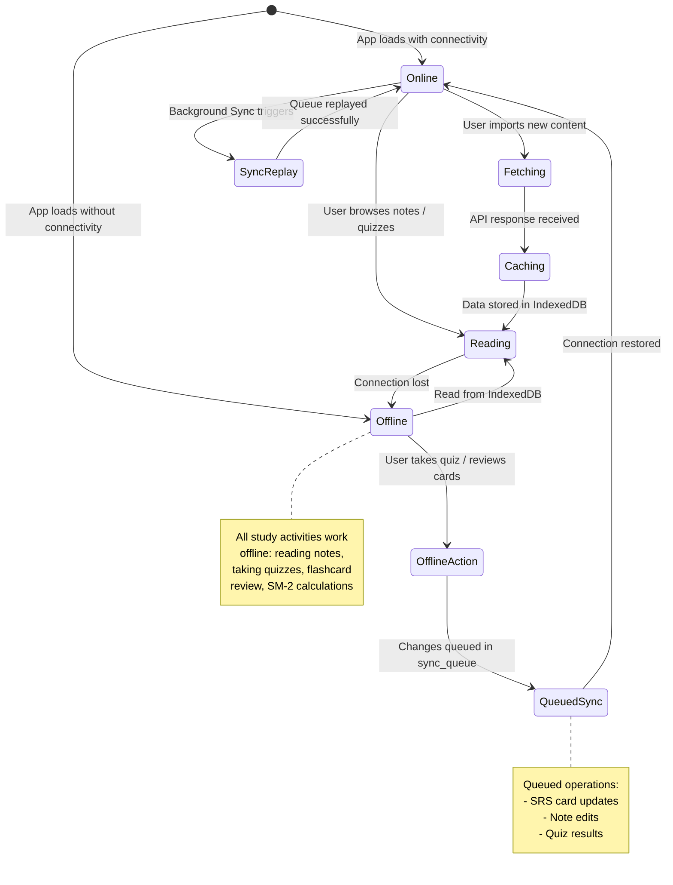

# SynapseSync — Design Overview & Architectural Decisions

> **Version:** 1.0  
> **Date:** 2026-09-10  
> **Status:** Draft  

---

## 1. Executive Summary

**SynapseSync** is a cross-platform, offline-first study companion that transforms passive notes into active learning material. It bridges the gap between laptop study sessions and mobile review by:

1. **Connecting to OneDrive** to import `.docx` and `.md` study notes
2. **Ingesting YouTube lecture playlists** via transcript extraction
3. **Generating AI-powered quizzes and flashcards** using Google Gemini
4. **Implementing spaced repetition (SM-2)** to optimize memory retention
5. **Working fully offline** as a Progressive Web App (PWA) with IndexedDB storage

---

## 2. High-Level System Diagram

---

## 3. Key Architectural Decisions

### ADR-01: Client-Heavy, Server-Thin Architecture

| Aspect     | Decision                                                                  |
|:-----------|:--------------------------------------------------------------------------|
| **Context**| Vercel free tier has 60s timeout, stateless functions, limited CPU hours  |
| **Decision**| Push all persistent state and compute-light operations to the browser    |
| **Rationale**| SM-2 algorithm, quiz scoring, note rendering, full-text search — all run client-side. Server only handles: document parsing, YouTube scraping, and Gemini API calls (which require server-side API key). |
| **Tradeoff**| Cross-device sync is not available in v1 (IndexedDB is per-browser)      |

### ADR-02: IndexedDB as Primary Data Store (No Server Database)

| Aspect     | Decision                                                                  |
|:-----------|:--------------------------------------------------------------------------|
| **Context**| Need persistent storage for notes, quizzes, SRS state; no budget for database |
| **Decision**| Use IndexedDB (via `idb` wrapper) as the sole data store                 |
| **Rationale**| Enables full offline functionality; ~50 MB+ capacity per origin; structured queries via indexes; zero cost |
| **Tradeoff**| Data is device-specific; user must re-import on a new device; risk of data loss if browser storage is cleared |

### ADR-03: Direct OneDrive API Calls from Browser

| Aspect     | Decision                                                                  |
|:-----------|:--------------------------------------------------------------------------|
| **Context**| Need to access user's OneDrive files; must use OAuth                     |
| **Decision**| Browser calls MS Graph API directly using MSAL.js + PKCE. Tokens never touch the backend. |
| **Rationale**| SPA registration requires no client secret; simpler architecture; reduces backend complexity; more secure (tokens don't traverse an intermediary) |
| **Tradeoff**| Must handle token refresh logic in the frontend; requires CORS-compatible API calls |

### ADR-04: Hybrid Python + Node.js Backend on Vercel

| Aspect     | Decision                                                                  |
|:-----------|:--------------------------------------------------------------------------|
| **Context**| User requires Python backend; YouTube transcript fetching needs server-side proxy (CORS blocks browser-direct); `youtube-transcript` npm is lighter than Python equivalent |
| **Decision**| **Hybrid runtime:** Python serverless functions for AI processing (Gemini) and document parsing; **Next.js API routes (Node.js)** for YouTube transcript/playlist fetching |
| **Rationale**| Python satisfies user requirement for AI/parsing endpoints; Node.js transcript route integrates naturally with Next.js and avoids Python cold-start overhead for YouTube calls; `youtube-transcript` npm is lightweight (~15 KB) |
| **Tradeoff**| Two runtimes increase deployment complexity slightly; must maintain both `requirements.txt` and `package.json` dependencies |

### ADR-05: Micro-Request Pattern for Heavy Operations

| Aspect     | Decision                                                                  |
|:-----------|:--------------------------------------------------------------------------|
| **Context**| YouTube playlists can have 50+ videos; processing all at once exceeds 60s |
| **Decision**| Frontend orchestrates: loops through videos one-at-a-time, calling `/api/transcript` per video |
| **Rationale**| Each individual request completes well within 60s; user sees real-time progress; failures are isolated to individual videos |
| **Tradeoff**| Total wall-clock time is higher (sequential); more function invocations (but well within 1M/month limit) |

### ADR-06: Dual-Path YouTube Transcript Strategy

| Aspect     | Decision                                                                  |
|:-----------|:--------------------------------------------------------------------------|
| **Context**| YouTube blocks CORS requests from browsers; Vercel datacenter IPs may also be blocked; user needs reliable transcript access |
| **Decision**| **Primary:** Next.js API route (Node.js) using `youtube-transcript` npm to proxy transcript fetches through Vercel. **Fallback:** Manual transcript paste UI — user copies transcript from YouTube and pastes into a text area |
| **Rationale**| CORS makes true client-side fetching impossible (browser blocks cross-origin requests to YouTube). Server-side proxying through Next.js API route keeps everything in one deployment. Manual paste guarantees 100% reliability regardless of IP blocking |
| **Tradeoff**| Server route may still face IP blocking (reduced vs. Python library); manual paste adds friction but guarantees functionality |

### ADR-07: Gemini Structured Output for Quiz Generation

| Aspect     | Decision                                                                  |
|:-----------|:--------------------------------------------------------------------------|
| **Context**| Need reliable, parseable quiz data from AI; free-form text is error-prone |
| **Decision**| Use Gemini's `response_mime_type: "application/json"` with a JSON schema |
| **Rationale**| Guarantees clean, structured responses; no regex parsing needed; reduces bugs in quiz rendering |
| **Tradeoff**| Slightly more tokens consumed for structured output; schema must be carefully designed |

### ADR-08: PWA Instead of Native App

| Aspect     | Decision                                                                  |
|:-----------|:--------------------------------------------------------------------------|
| **Context**| Need cross-platform (laptop + phone) with offline capability             |
| **Decision**| Build as PWA with Service Worker and Web App Manifest                    |
| **Rationale**| Single codebase; installable on both iOS and Android home screens; offline via Service Worker + IndexedDB; no app store submission required |
| **Tradeoff**| Slightly less native feel than React Native; limited push notification support on iOS; depends on browser cache policies |

---

## 4. Component Interaction Flows

### 4.1 Complete User Journey: Import → Study → Review

### 4.2 YouTube Playlist Ingestion Flow

---

## 5. Offline-First Sync Strategy

---

## 6. Risk Analysis & Mitigations

| # | Risk                                              | Probability | Impact | Mitigation                                                    |
|:--|:--------------------------------------------------|:------------|:-------|:--------------------------------------------------------------|
| 1 | YouTube blocks transcript fetching from Vercel IPs | **Medium** (reduced from High) | Medium | Node.js API route as proxy; manual paste fallback; cache aggressively; retry + backoff |
| 2 | Gemini free tier rate limits hit during heavy use   | **Medium**  | Medium | Client-side throttling (4s between requests); cache all generated quizzes |
| 3 | Vercel function timeout (60s) on large documents    | **Medium**  | Medium | Truncate documents to ~8000 words; process in chunks          |
| 4 | IndexedDB cleared by browser                        | **Low**     | High   | Warn users about browser storage policies; export feature (v2)|
| 5 | MSAL.js token refresh fails silently               | **Low**     | Medium | Detect 401 responses; prompt re-login; cache token expiry     |
| 6 | Large playlists (100+ videos) take very long         | **Medium**  | Low    | Show progress UI; allow pause/resume; process in background   |
| 7 | Gemini generates incorrect quiz answers              | **Medium**  | Medium | Show explanations with answers; allow user to flag/report     |
| 8 | PWA install experience varies across browsers        | **Medium**  | Low    | Test on Chrome, Safari, Firefox; provide manual install guide |
| 9 | CORS prevents direct browser-to-YouTube transcript fetch | **Certain** | N/A  | Acknowledged; proxied through Next.js API route by design     |

---

## 7. Design Document Index

| # | Document                                                                                              | Description                                        |
|:--|:------------------------------------------------------------------------------------------------------|:---------------------------------------------------|
| 1 | [Product Requirements](file:///home/somesh/git_repos/synapse-sync/documentation/design/high_level/01_product_requirements.md) | Features, user stories, constraints, success metrics |
| 2 | [System Architecture](file:///home/somesh/git_repos/synapse-sync/documentation/design/high_level/02_system_architecture.md)   | Components, data flows, project structure, tech stack |
| 3 | [Data Models](file:///home/somesh/git_repos/synapse-sync/documentation/design/high_level/03_data_models.md)                   | IndexedDB schemas, SM-2 algorithm, Gemini schemas   |
| 4 | [API Specifications](file:///home/somesh/git_repos/synapse-sync/documentation/design/high_level/04_api_specifications.md)     | Endpoint specs, request/response formats, rate limiting |
| 5 | [Deployment Guide](file:///home/somesh/git_repos/synapse-sync/documentation/design/high_level/05_deployment_guide.md)         | Vercel setup, PWA config, CI/CD, monitoring          |
| 6 | [Design Overview](file:///home/somesh/git_repos/synapse-sync/documentation/design/high_level/06_design_overview.md) (this doc) | ADRs, flows, risks, technology rationale            |

---

## 8. Technology Comparison: Why These Choices?

### Frontend Framework

| Option     | Pros                              | Cons                           | Verdict      |
|:-----------|:----------------------------------|:-------------------------------|:-------------|
| **Next.js**| Native Vercel support; SSR; App Router | Heavier than pure SPA       | ✅ **Selected** |
| Vite + React | Lightweight; fast dev server   | No SSR; requires separate routing | Considered   |
| SvelteKit  | Small bundle; great DX            | Smaller ecosystem              | Considered   |

### Offline Storage

| Option       | Pros                             | Cons                           | Verdict      |
|:-------------|:---------------------------------|:-------------------------------|:-------------|
| **IndexedDB** | Large capacity; structured queries; free | Complex API (mitigated by `idb`) | ✅ **Selected** |
| localStorage | Simple API                       | 5-10 MB limit; strings only    | Too small    |
| SQLite (WASM) | Full SQL; familiar              | Large WASM bundle; complex setup | Overkill    |
| Supabase     | Real-time sync; SQL              | Requires internet; free tier limits | Future v2  |

### AI Model

| Option          | Pros                            | Cons                           | Verdict      |
|:----------------|:--------------------------------|:-------------------------------|:-------------|
| **Gemini Flash**| Free tier; structured output; fast | Data may train models; rate limits | ✅ **Selected** (per user requirement) |
| GPT-4o Mini     | High quality; structured output | Paid only; no free tier        | Not viable   |
| Claude Haiku    | Fast; good quality              | Paid only                      | Not viable   |
| Local LLM       | Private; no rate limits         | Can't run in browser/serverless | Not viable   |

### YouTube Transcripts

| Option                    | Pros                          | Cons                           | Verdict      |
|:--------------------------|:------------------------------|:-------------------------------|:-------------|
| **`youtube-transcript` (npm)** | Node.js; lightweight; integrates with Next.js | Still faces datacenter IP blocking | ✅ **Selected** (primary, via Next.js API route) |
| `youtube-transcript-api` (Python) | Mature; feature-rich; user originally requested | Heavier; CORS means can't run client-side; IP blocking | ✅ **Available** (Python fallback) |
| Direct browser fetch     | Uses residential IP (no blocking!) | **CORS blocks all browser→YouTube requests** | ❌ Not viable (CORS) |
| YouTube Data API          | Official; reliable            | Requires API key; quota limits; no transcript endpoint | Not viable |
| Managed API service       | Most reliable; maintained     | Costs money                    | Future upgrade |
| Manual paste              | 100% reliable; no API needed  | Requires user effort           | ✅ **Selected** (fallback) |
