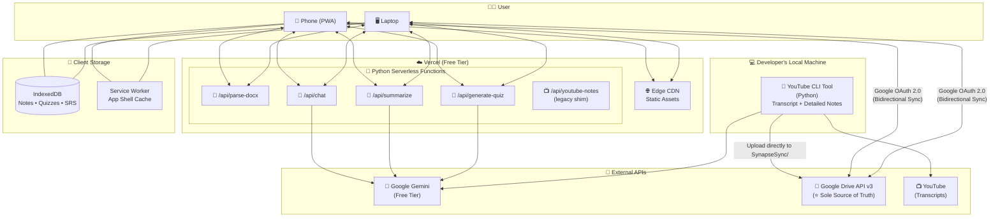
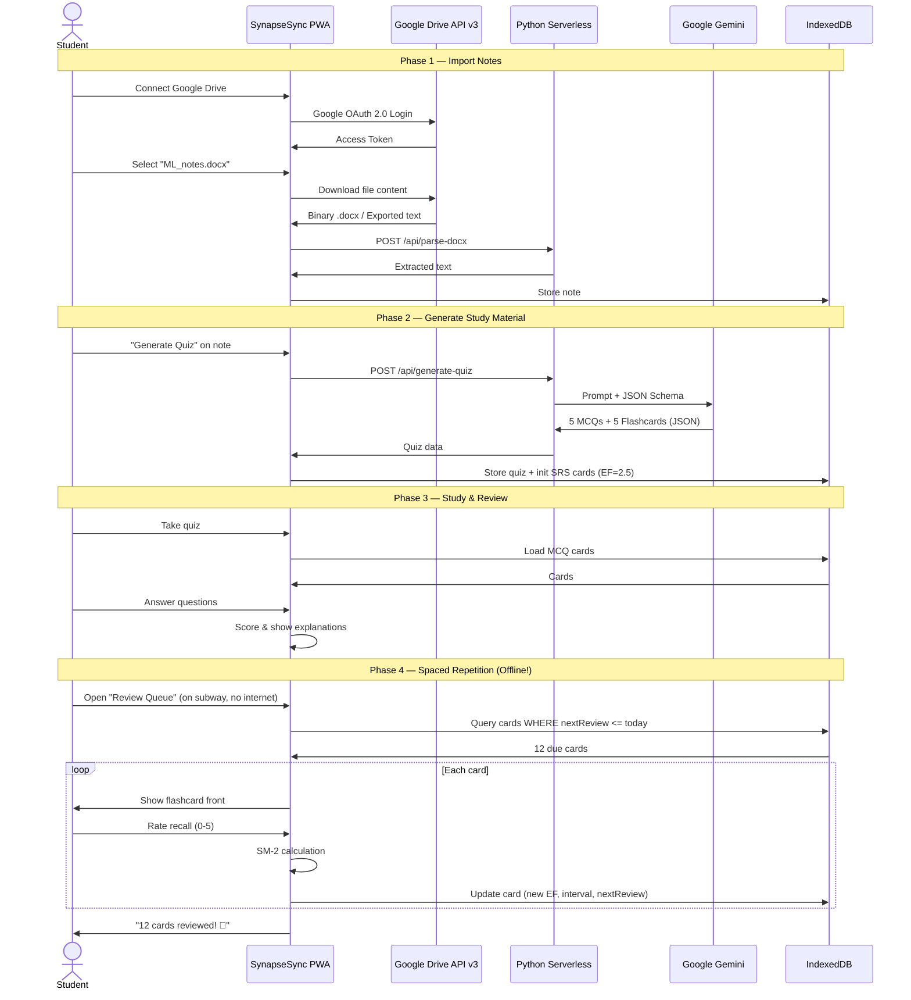
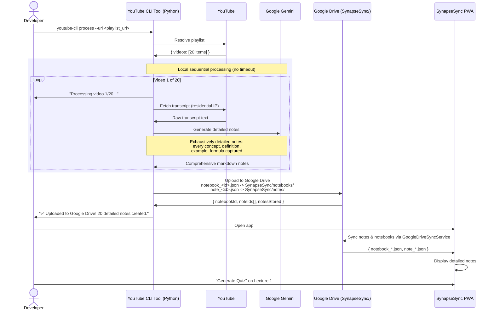
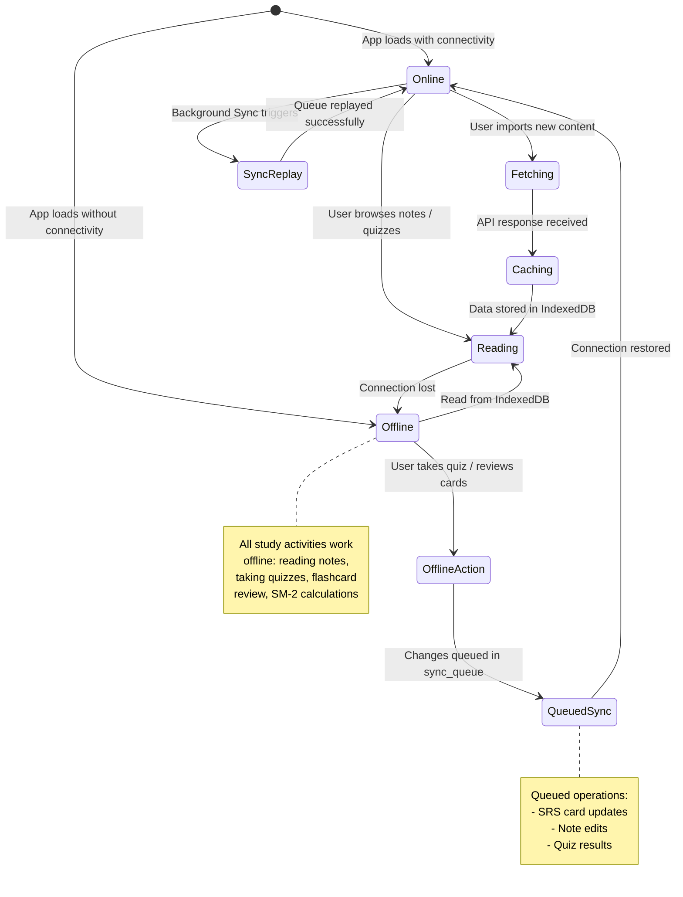

# SynapseSync — Design Overview & Architectural Decisions

> **Version:** 1.1  
> **Date:** 2026-10-19  
> **Status:** Draft  

---

## 1. Executive Summary

**SynapseSync** is a cross-platform, offline-first study companion that transforms passive notes into active learning material. It bridges the gap between laptop study sessions and mobile review by:

1. **Connecting to Google Drive** to import `.docx`, `.md`, and Google Docs study notes
2. **Ingesting YouTube lecture playlists** via transcript extraction
3. **Generating AI-powered quizzes and flashcards** using Google Gemini
4. **Implementing spaced repetition (SM-2)** to optimize memory retention
5. **Working fully offline** as a Progressive Web App (PWA) with IndexedDB storage

---

## 2. High-Level System Diagram

---

## 3. Key Architectural Decisions

### ADR-01: Client-Heavy, Server-Thin Architecture

| Aspect     | Decision                                                                  |
|:-----------|:--------------------------------------------------------------------------|
| **Context**| Vercel free tier has 60s timeout, stateless functions, limited CPU hours  |
| **Decision**| Push all persistent state and compute-light operations to the browser    |
| **Rationale**| SM-2 algorithm, quiz scoring, note rendering, full-text search — all run client-side. Server only handles: document parsing, YouTube scraping, and Gemini API calls (which require server-side API key). |
| **Tradeoff**| Cross-device sync is not available in v1 (IndexedDB is per-browser)      |

### ADR-02: IndexedDB as Primary Data Store (No Server Database)

| Aspect     | Decision                                                                  |
|:-----------|:--------------------------------------------------------------------------|
| **Context**| Need persistent storage for notes, quizzes, SRS state; no budget for database |
| **Decision**| Use IndexedDB (via `idb` wrapper) as the sole data store                 |
| **Rationale**| Enables full offline functionality; ~50 MB+ capacity per origin; structured queries via indexes; zero cost |
| **Tradeoff**| Data is device-specific; user must re-import on a new device; risk of data loss if browser storage is cleared |

### ADR-03: Direct Google Drive API Calls from Browser

| Aspect     | Decision                                                                  |
|:-----------|:--------------------------------------------------------------------------|
| **Context**| Need to browse, read, and write user's Google Drive files; must use OAuth 2.0 |
| **Decision**| Browser calls Google Drive API v3 directly using Google OAuth 2.0. Tokens never touch the backend. |
| **Rationale**| Client-side token flow requires no client secret; simpler architecture; reduces backend complexity; zero proxy latency; tokens remain strictly client-side. |
| **Tradeoff**| Must handle token refresh and expiration in the frontend; requires CORS-compatible Google API endpoints |

### ADR-04: Pure Python Backend + Local CLI Tool

| Aspect     | Decision                                                                  |
|:-----------|:--------------------------------------------------------------------------|
| **Context**| User requires Python backend; YouTube transcript fetching from cloud IPs gets blocked by YouTube; Gemini needs unrestricted time to generate detailed notes |
| **Decision**| **Pure Python backend:** All Vercel serverless functions run Python. **Local CLI tool:** A separate Python CLI tool runs on the developer's local machine for YouTube transcript fetching and detailed note generation. Results are uploaded directly to the user's dedicated Google Drive folder (`SynapseSync/`). |
| **Rationale**| Local machine uses residential IP — YouTube never blocks residential IPs. Local execution removes the 60-second Vercel timeout, allowing Gemini to generate exhaustively detailed notes. Direct upload to Google Drive keeps Google Drive as the sole source of truth and eliminates server-side storage. |
| **Tradeoff**| Requires running a CLI tool locally with Google Drive credentials (`GOOGLE_DRIVE_ACCESS_TOKEN`); PWA syncs notes upon completion |

### ADR-05: Local Sequential Processing for YouTube

| Aspect     | Decision                                                                  |
|:-----------|:--------------------------------------------------------------------------|
| **Context**| YouTube playlists can have 50+ videos; each video needs transcript fetching AND detailed note generation via Gemini |
| **Decision**| Local CLI tool processes videos one-at-a-time sequentially, with no timeout constraints |
| **Rationale**| Local processing has no 60-second timeout. Gemini can take as long as needed to generate comprehensive, detailed notes. Sequential processing respects Gemini rate limits naturally. Progress is shown in the CLI terminal. |
| **Tradeoff**| Total wall-clock time can be significant for large playlists (but runs unattended); requires local machine to be online during processing |

### ADR-06: Local-First YouTube Transcript Strategy

| Aspect     | Decision                                                                  |
|:-----------|:--------------------------------------------------------------------------|
| **Context**| YouTube blocks CORS requests from browsers AND aggressively blocks cloud/datacenter IPs; detailed note generation requires significant Gemini API time |
| **Decision**| **Primary:** Local Python CLI tool fetches transcripts using `youtube-transcript-api` from the developer's residential IP, generates detailed notes via Gemini locally, and uploads the final results directly to Google Drive. **Fallback:** Manual transcript paste UI in the PWA for individual videos (saved to local IndexedDB and synced to Google Drive) |
| **Rationale**| Residential IPs are never blocked by YouTube. Local execution eliminates both the CORS problem (no browser involved) and the cloud IP blocking problem. Unlimited processing time enables Gemini to generate truly detailed, comprehensive notes rather than rushed summaries. Direct Google Drive upload ensures no server note storage is needed. |
| **Tradeoff**| Extra step for the user (run CLI tool); notes sync down to PWA from Google Drive; manual paste is still available as PWA fallback |

### ADR-07: Gemini Structured Output for Quiz Generation

| Aspect     | Decision                                                                  |
|:-----------|:--------------------------------------------------------------------------|
| **Context**| Need reliable, parseable quiz data from AI; free-form text is error-prone |
| **Decision**| Use Gemini's `response_mime_type: "application/json"` with a JSON schema |
| **Rationale**| Guarantees clean, structured responses; no regex parsing needed; reduces bugs in quiz rendering |
| **Tradeoff**| Slightly more tokens consumed for structured output; schema must be carefully designed |

### ADR-08: PWA Instead of Native App

| Aspect     | Decision                                                                  |
|:-----------|:--------------------------------------------------------------------------|
| **Context**| Need cross-platform (laptop + phone) with offline capability             |
| **Decision**| Build as PWA with Service Worker and Web App Manifest                    |
| **Rationale**| Single codebase; installable on both iOS and Android home screens; offline via Service Worker + IndexedDB; no app store submission required |
| **Tradeoff**| Slightly less native feel than React Native; limited push notification support on iOS; depends on browser cache policies |

### ADR-09: Google Drive as Primary User Identity & Multi-User Context Boundary

| Aspect     | Decision                                                                  |
|:-----------|:--------------------------------------------------------------------------|
| **Context**| Multiple team members and students use the application without wanting a separate backend database, user table, or custom auth server. Each user has their own Google Drive account and assigned OAuth Client ID. |
| **Decision**| Google Drive acts as the sole user authentication boundary. A user combobox beside the connect button lets users select their pre-registered profile (`SC`, `DB`), dynamically applying their `NEXT_PUBLIC_GOOGLE_CLIENT_ID`. Connecting pulls all notes, quizzes, and complete learning state (`SynapseSync/app_state.json`). Disconnecting triggers an automatic pre-logout flush (`forceSync`) before transactionally purging all 9 IndexedDB stores and resetting the UI to default `0` counters. |
| **Rationale**| Eliminates server-side user data storage completely. Guarantees 100% data isolation on shared devices. Provides instant multi-user switching without backend maintenance overhead. Automatic background sync (periodic, visibility, reconnect) and pre-logout flushing ensure users never need to manually force sync before disconnecting. |
| **Tradeoff**| Requires remote pull when reconnecting after a user switch or logout due to the security purge. |

---

## 4. Component Interaction Flows

### 4.1 Complete User Journey: Import → Study → Review

### 4.2 YouTube Playlist Ingestion Flow (Local-First)

---

## 5. Offline-First Sync Strategy

---

## 6. Risk Analysis & Mitigations

| # | Risk                                              | Probability | Impact | Mitigation                                                    |
|:--|:--------------------------------------------------|:------------|:-------|:--------------------------------------------------------------|
| 1 | YouTube blocks transcript fetching                 | **Very Low** (eliminated) | N/A | Local CLI uses residential IP; YouTube does not block residential IPs |
| 2 | Gemini free tier rate limits hit during heavy use   | **Medium**  | Medium | Local CLI has built-in delay between requests; cache all generated notes |
| 3 | Vercel function timeout (60s) on large documents    | **Medium**  | Medium | Truncate documents to ~8000 words; YouTube processing runs locally (no timeout) |
| 4 | IndexedDB cleared by browser                        | **Low**     | High   | Warn users about browser storage policies; Google Drive is the sole source of truth and all notes/quizzes can be re-synced |
| 5 | Google OAuth token expires or refresh fails         | **Low**     | Medium | Detect 401 responses; prompt re-login; track token expiry in session |
| 6 | Large playlists (100+ videos) take very long locally | **Medium**  | Low   | Show CLI progress; allow resume from where it left off; process overnight |
| 7 | Gemini generates incorrect quiz answers              | **Medium**  | Medium | Show explanations with answers; allow user to flag/report     |
| 8 | PWA install experience varies across browsers        | **Medium**  | Low    | Test on Chrome, Safari, Firefox; provide manual install guide |
| 9 | Local CLI fails to upload notes to Google Drive      | **Low**     | Low    | Notes are cached locally; can retry push with `--drive-folder` / `--drive-token`; clear error messages |

---

## 7. Design Document Index

| # | Document                                                                                              | Description                                        |
|:--|:------------------------------------------------------------------------------------------------------|:---------------------------------------------------|
| 1 | [Product Requirements](file:///home/somesh/git_repos/synapse-sync/documentation/design/high_level/01_product_requirements.md) | Features, user stories, constraints, success metrics |
| 2 | [System Architecture](file:///home/somesh/git_repos/synapse-sync/documentation/design/high_level/02_system_architecture.md)   | Components, data flows, project structure, tech stack |
| 3 | [Data Models](file:///home/somesh/git_repos/synapse-sync/documentation/design/high_level/03_data_models.md)                   | IndexedDB schemas, SM-2 algorithm, Gemini schemas   |
| 4 | [API Specifications](file:///home/somesh/git_repos/synapse-sync/documentation/design/high_level/04_api_specifications.md)     | Endpoint specs, request/response formats, rate limiting |
| 5 | [Deployment Guide](file:///home/somesh/git_repos/synapse-sync/documentation/design/high_level/05_deployment_guide.md)         | Vercel setup, PWA config, CI/CD, monitoring          |
| 6 | [Design Overview](file:///home/somesh/git_repos/synapse-sync/documentation/design/high_level/06_design_overview.md) (this doc) | ADRs, flows, risks, technology rationale            |

---

## 8. Technology Comparison: Why These Choices?

### Frontend Framework

| Option     | Pros                              | Cons                           | Verdict      |
|:-----------|:----------------------------------|:-------------------------------|:-------------|
| **Next.js**| Native Vercel support; SSR; App Router | Heavier than pure SPA       | ✅ **Selected** |
| Vite + React | Lightweight; fast dev server   | No SSR; requires separate routing | Considered   |
| SvelteKit  | Small bundle; great DX            | Smaller ecosystem              | Considered   |

### Offline Storage

| Option       | Pros                             | Cons                           | Verdict      |
|:-------------|:---------------------------------|:-------------------------------|:-------------|
| **IndexedDB** | Large capacity; structured queries; free | Complex API (mitigated by `idb`) | ✅ **Selected** |
| localStorage | Simple API                       | 5-10 MB limit; strings only    | Too small    |
| SQLite (WASM) | Full SQL; familiar              | Large WASM bundle; complex setup | Overkill    |
| Supabase     | Real-time sync; SQL              | Requires internet; free tier limits | Future v2  |

### AI Model

| Option          | Pros                            | Cons                           | Verdict      |
|:----------------|:--------------------------------|:-------------------------------|:-------------|
| **Gemini Flash**| Free tier; structured output; fast | Data may train models; rate limits | ✅ **Selected** (per user requirement) |
| GPT-4o Mini     | High quality; structured output | Paid only; no free tier        | Not viable   |
| Claude Haiku    | Fast; good quality              | Paid only                      | Not viable   |
| Local LLM       | Private; no rate limits         | Can't run in browser/serverless | Not viable   |

### YouTube Transcripts

| Option                    | Pros                          | Cons                           | Verdict      |
|:--------------------------|:------------------------------|:-------------------------------|:-------------|
| **`youtube-transcript-api` (Python, local)** | Runs locally; residential IP never blocked; full Python ecosystem; no timeout | Requires running a CLI tool | ✅ **Selected** (primary, via local CLI) |
| `youtube-transcript` (npm, Vercel) | Node.js; lightweight | Cloud IP blocking; 60s timeout | ❌ Replaced by local approach |
| Direct browser fetch     | Uses residential IP | **CORS blocks all browser→YouTube requests** | ❌ Not viable (CORS) |
| YouTube Data API          | Official; reliable            | Requires API key; quota limits; no transcript endpoint | Not viable |
| Managed API service       | Most reliable; maintained     | Costs money                    | Future upgrade |
| Manual paste              | 100% reliable; no API needed  | Requires user effort           | ✅ **Selected** (PWA fallback) |

### Cloud Note Storage

| Option                       | Pros                                                    | Cons                                      | Verdict      |
|:-----------------------------|:--------------------------------------------------------|:------------------------------------------|:-------------|
| **Google Drive API v3**      | Broad student adoption; native Google Docs export; full read/write support; robust OAuth 2.0 | Token refresh lifecycle handling | ✅ **Selected** |
| Microsoft OneDrive (MS Graph)| Enterprise/education presence                           | Deprecated in favor of Google ecosystem   | ❌ Replaced  |
| Dropbox                      | Simple file API                                         | Smaller student footprint; paid tiers     | Not viable   |
| Notion API                   | Rich block structure                                    | Complex API; proprietary formatting       | Future v2    |
