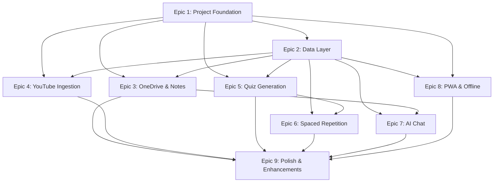

# SynapseSync — Execution Plan Overview

> **Version:** 1.0  
> **Date:** 2026-09-27  
> **Status:** Draft  
> **Source:** [High-Level Design Documents](file:///home/somesh/git_repos/synapse-sync/documentation/design/high_level)  
> **Coding Standards:** [coding_standards.md](file:///home/somesh/git_repos/synapse-sync/documentation/prompts/coding_standards.md)

---

## How This Plan Works

This plan breaks the SynapseSync build into **9 Epics**, each with **Stories** and **Tasks**. Each epic has its own detailed plan document (linked below). The epics are ordered by dependency — earlier epics provide the foundation for later ones.

### Conventions

- **Epic** = A major feature area (e.g., "Note Management", "Quiz Generation")
- **Story** = A user-visible capability within an epic (e.g., "User can browse OneDrive files")
- **Task** = A concrete, implementable unit of work that a developer (or AI agent) can pick up and complete independently

### Coding Standards (Always Apply)

All implementation work **must** follow the [Coding Standards](file:///home/somesh/git_repos/synapse-sync/documentation/prompts/coding_standards.md). Key highlights:

- Strict OOP — all functions inside classes, one class per file
- Methods ≤ 20 lines, files ≤ 500 lines
- Python virtual env: `source ~/python_envs/p313_llm/bin/activate`
- 90%+ test coverage with pytest
- Local CI must pass (ruff + mypy + pytest) before any task is marked complete
- No magic strings/numbers — use named constants
- SOLID, DRY, YAGNI at all times

### Python Virtual Environment

```bash
source ~/python_envs/p313_llm/bin/activate
```

Use this for **all** Python work (backend API functions, tests, linting).

---

## Epic Index

| # | Epic | Plan Document | Priority | Depends On |
|:--|:-----|:--------------|:---------|:-----------|
| 1 | Project Foundation & Setup | [01_project_foundation.md](file:///home/somesh/git_repos/synapse-sync/documentation/plans/01_project_foundation.md) | P0 | — |
| 2 | Client-Side Data Layer (IndexedDB) | [02_data_layer.md](file:///home/somesh/git_repos/synapse-sync/documentation/plans/02_data_layer.md) | P0 | Epic 1 |
| 3 | OneDrive Integration & Note Management | [03_onedrive_notes.md](file:///home/somesh/git_repos/synapse-sync/documentation/plans/03_onedrive_notes.md) | P0 | Epic 1, Epic 2 |
| 4 | YouTube Transcript Ingestion | [04_youtube_ingestion.md](file:///home/somesh/git_repos/synapse-sync/documentation/plans/04_youtube_ingestion.md) | P0 | Epic 1, Epic 2 |
| 5 | AI-Powered Quiz & Flashcard Generation | [05_quiz_generation.md](file:///home/somesh/git_repos/synapse-sync/documentation/plans/05_quiz_generation.md) | P0 | Epic 1, Epic 2 |
| 6 | Spaced Repetition System (SM-2) | [06_spaced_repetition.md](file:///home/somesh/git_repos/synapse-sync/documentation/plans/06_spaced_repetition.md) | P0 | Epic 2, Epic 5 |
| 7 | AI Study Assistant (Chat) | [07_ai_chat.md](file:///home/somesh/git_repos/synapse-sync/documentation/plans/07_ai_chat.md) | P0 | Epic 1, Epic 2, Epic 3 |
| 8 | PWA & Offline-First | [08_pwa_offline.md](file:///home/somesh/git_repos/synapse-sync/documentation/plans/08_pwa_offline.md) | P0 | Epic 1, Epic 2 |
| 9 | Polish, Theming & Enhancements | [09_polish_enhancements.md](file:///home/somesh/git_repos/synapse-sync/documentation/plans/09_polish_enhancements.md) | P1 | All prior epics |

---

## Dependency Graph



---

## Recommended Execution Order

The epics should be executed roughly in this order. Some epics can run in parallel once their dependencies are met.

### Phase 1 — Foundation (Must be first)
1. **Epic 1** — Project Foundation & Setup

### Phase 2 — Core Data (Must follow Phase 1)
2. **Epic 2** — Client-Side Data Layer (IndexedDB)

### Phase 3 — Feature Tracks (Can run in parallel after Phase 2)
3. **Epic 3** — OneDrive & Note Management
4. **Epic 4** — YouTube Transcript Ingestion
5. **Epic 5** — Quiz & Flashcard Generation

### Phase 4 — Dependent Features (After Phase 3)
6. **Epic 6** — Spaced Repetition (needs Epic 5)
7. **Epic 7** — AI Chat (needs Epic 3)

### Phase 5 — Platform (Can start during Phase 3)
8. **Epic 8** — PWA & Offline-First

### Phase 6 — Final Polish
9. **Epic 9** — Polish, Theming & Enhancements

---

## Story Point Summary

| Epic | Stories | Estimated Complexity |
|:-----|:--------|:---------------------|
| 1. Project Foundation | 4 | Medium |
| 2. Data Layer | 3 | Medium-High |
| 3. OneDrive & Notes | 5 | High |
| 4. YouTube Ingestion | 4 | High |
| 5. Quiz Generation | 4 | Medium-High |
| 6. Spaced Repetition | 3 | Medium |
| 7. AI Chat | 3 | Medium |
| 8. PWA & Offline | 4 | Medium-High |
| 9. Polish & Enhancements | 5 | Medium |
| **Total** | **35 stories** | — |
