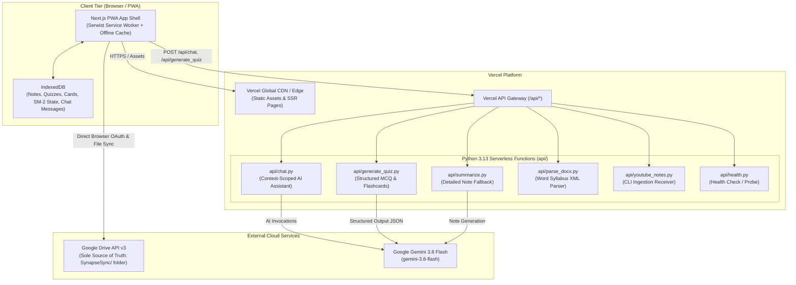

# Vercel Production Deployment Guide

> **Target Audience:** Developers deploying SynapseSync to production on Vercel.  
> **Last Updated:** October 2026  
> **Stack:** Next.js 16.4.2 (App Router), Python 3.13 Serverless Functions, Google Drive API v3, Google Gemini 3.8 Flash (`gemini-3.8-flash`)

This guide provides end-to-end instructions for deploying SynapseSync to production on [Vercel](https://vercel.com/) with a connected GitHub repository.

---

## 1. Architecture Overview on Vercel

SynapseSync utilizes a hybrid serverless deployment model on Vercel:



* **Frontend Web App & Static Assets:** Next.js 16 App Router hosted across Vercel's global CDN with cache-first PWA asset routing.
* **Serverless Backend APIs:** Python 3.13 Lambda functions under `api/` automatically discovered and provisioned by Vercel with dependencies from `api/requirements.txt`.
* **Zero Database Server:** User data is stored in the browser's IndexedDB and synced directly to the user's personal Google Drive in the `SynapseSync/` directory. No persistent database servers (PostgreSQL/MongoDB) need to be provisioned or maintained.
* **AI Engine:** Google Gemini 3.8 Flash (`gemini-3.8-flash`) invoked through Google AI Studio API keys.

---

## 2. Prerequisites

Before deploying to production, ensure you have:

1. A **Vercel Account** ([vercel.com](https://vercel.com/)) with your GitHub repository connected.
2. A **Google Cloud Project** with Google Drive API v3 enabled and an OAuth 2.0 Web Client ID configured (see [Google Drive Setup Guide](./google_drive_setup.md)).
3. A **Google Gemini API Key** generated from [Google AI Studio](https://aistudio.google.com/) with access to `gemini-3.8-flash`.

---

## 3. Step 1: Configure Google Cloud OAuth for Vercel Domain

Google OAuth strictly enforces origin and redirect matching. You must add your production Vercel domain to your OAuth 2.0 Client credentials:

1. Go to the [Google Cloud Console Credentials Page](https://console.cloud.google.com/apis/credentials).
2. Under **OAuth 2.0 Client IDs**, click your web client name (e.g., `SynapseSync Web Client`).
3. Under **Authorized JavaScript origins**, click **+ ADD URI** and add:
   * `https://<your-project-name>.vercel.app`
   * *(Optional)* If using a custom domain: `https://synapse.yourdomain.com`
4. Under **Authorized redirect URIs**, click **+ ADD URI** and add:
   * `https://<your-project-name>.vercel.app`
   * *(Optional)* If using a custom domain: `https://synapse.yourdomain.com`
5. Click **Save** at the bottom of the page.

> [!IMPORTANT]
> Do NOT include a trailing slash in the origin or redirect URI (e.g., use `https://synapse-sync.vercel.app`, NOT `https://synapse-sync.vercel.app/`). Google OAuth will reject redirect URLs with trailing slashes.

> [!NOTE]
> If your Google Cloud OAuth Consent Screen is in **Testing** status, only email addresses explicitly added under **Test users** can sign in. If you want other users or accounts to authenticate, either add their emails to the Test users list or publish your app to Production status.

---

## 4. Step 2: Configure Environment Variables in Vercel

In the Vercel Dashboard:
1. Navigate to your project: **Settings** → **Environment Variables**.
2. Add each of the following variables for the **Production** environment:

| Variable Name | Required | Example / Description |
|:---|:---:|:---|
| `GEMINI_API_KEY` | **Yes** | API key from Google AI Studio (e.g., `AIzaSy...`). Used by Python serverless functions for `gemini-3.8-flash` quizzing, note generation, and study chat. |
| `NEXT_PUBLIC_GOOGLE_CLIENT_ID` | **Yes** | Primary Google OAuth 2.0 Client ID (e.g., `53873069339-xxxx.apps.googleusercontent.com`). Exposed to the browser for Google login. |
| `NEXT_PUBLIC_GOOGLE_CLIENT_ID_SC` | Optional | User-specific Client ID for multi-user context isolation (e.g., user `SC`). Can be the same as primary client ID. |
| `NEXT_PUBLIC_GOOGLE_CLIENT_ID_DB` | Optional | User-specific Client ID for multi-user context isolation (e.g., user `DB`). Can be the same as primary client ID. |
| `NEXT_PUBLIC_GOOGLE_REDIRECT_URI` | **Yes** | Your production Vercel URL (e.g., `https://synapse-sync.vercel.app`). Must match Authorized Redirect URIs in Google Cloud Console. |
| `NEXT_PUBLIC_API_URL` | **Yes** | Your production Vercel URL (e.g., `https://synapse-sync.vercel.app`). Used by client services to call `/api/*`. |
| `YOUTUBE_NOTES_API_KEY` | **Yes** | A high-entropy random string (e.g. `prod-secret-synapse-yt-98214`). Secures the `/api/youtube_notes` webhook against unauthorized pushes. |

### Setting Environment Variables via Vercel CLI (Alternative)

If you prefer using the command line:

```bash
# Link your local directory to the Vercel project
vercel link

# Add environment variables interactively to Production
vercel env add GEMINI_API_KEY production
vercel env add NEXT_PUBLIC_GOOGLE_CLIENT_ID production
vercel env add NEXT_PUBLIC_GOOGLE_CLIENT_ID_SC production
vercel env add NEXT_PUBLIC_GOOGLE_CLIENT_ID_DB production
vercel env add NEXT_PUBLIC_GOOGLE_REDIRECT_URI production
vercel env add NEXT_PUBLIC_API_URL production
vercel env add YOUTUBE_NOTES_API_KEY production
```

---

## 5. Step 3: Verify Project Build Settings

SynapseSync includes pre-configured deployment settings in `vercel.json` and `package.json`:

* **Framework Preset:** Next.js
* **Root Directory:** `./`
* **Build Command:** `npm run build`
  *(Runs `next build --webpack`. Webpack compilation is required by `@serwist/next` to bundle the service worker for PWA offline caching).*
* **Output Directory:** `.next` (Vercel default)
* **Install Command:** `npm install`
* **Node.js Version:** `20.x` or `22.x` (Configured in Vercel Project Settings)
* **Python Runtime:** Python 3.13 (Vercel automatically detects `.py` files in `api/` and installs dependencies specified in `api/requirements.txt`).

### Security Headers & CORS (`vercel.json`)

The project's `vercel.json` automatically injects headers on Vercel:
* CORS headers on `/api/(.*)` allow browser requests from authorized web origins.
* Security headers (`X-Frame-Options: DENY`, `X-Content-Type-Options: nosniff`, `Referrer-Policy: strict-origin-when-cross-origin`) are applied across all routes.

---

## 6. Step 4: Deploying to Production

### Method A: Automated Deployment via GitHub (Recommended)

1. Commit and push your changes to your repository's production branch (usually `main`):
   ```bash
   git add .
   git commit -m "Configure production deployment"
   git push origin main
   ```
2. Vercel automatically detects the push via GitHub Webhook, checks out the code, builds the Next.js bundle, installs `api/requirements.txt`, and promotes the deployment to Production.
3. Monitor build progress under the **Deployments** tab in your Vercel Dashboard.

### Method B: Manual Deployment via Vercel CLI

```bash
# Ensure dependencies are installed and tests pass
npm test
source ~/python_envs/p313_llm/bin/activate && pytest

# Deploy directly to production
vercel --prod
```

---

## 7. Step 5: Post-Deployment Smoke Testing & Verification

Once the production deployment completes, run through this verification checklist:

### 1. API Health Check
Open the health check endpoint in your browser:
```
https://<your-project-name>.vercel.app/api/health
```
**Expected response:**
```json
{
  "status": "ok",
  "version": "1.0.0"
}
```
*If this returns 200, Vercel's Python serverless runtime is executing properly.*

### 2. App Shell & PWA Registration
1. Navigate to `https://<your-project-name>.vercel.app`.
2. Open Chrome DevTools (`F12`) → **Application** tab:
   * **Manifest:** Verify manifest is loaded with SynapseSync icons and theme colors.
   * **Service Workers:** Verify `sw.js` is active and running.
   * **Storage / IndexedDB:** Verify `synapse-sync-db` exists with 9 object stores.

### 3. Google Drive Authentication
1. Click **Connect Google Drive** in the header.
2. Sign in with your Google Account.
3. Grant permissions for Google Drive.
4. **Verification:** The connect button should show your Google account name/email, and the user selector dropdown should be active.

### 4. Google Drive Cloud State Sync
1. Navigate to **Settings** (`/settings`).
2. Click **Force Sync Now**.
3. Open your [Google Drive](https://drive.google.com/):
   * Verify that a root folder named `SynapseSync` was created.
   * Check that `app_state.json` is created with your study stats and preferences.

### 5. AI Quizzing with Gemini 3.8 Flash
1. Navigate to **Notes** (`/notes`) and select or import any note.
2. Click **Generate Quiz**.
3. **Verification:** Within a few seconds, 5 multiple-choice questions and 5 flashcards should be generated and presented.
4. Answer questions and verify SM-2 card scheduling is created.

### 6. AI Note Chat & Chat Persistence
1. In the note view or at `/chat`, send a question to the AI tutor (e.g., *"Summarize the main concepts"*).
2. Verify Gemini 3.8 Flash responds with context-grounded Markdown answers.
3. Check Google Drive: `SynapseSync/chats/chat_<noteId>.json` is created with the conversation history for that specific note, ensuring isolated and lightweight cloud persistence.

---

## 8. Troubleshooting & Common Production Pitfalls

### Issue 1: `redirect_uri_mismatch` (Google 400 Error)
* **Symptom:** Clicking "Connect Google Drive" opens a Google error popup: `Error 400: redirect_uri_mismatch`.
* **Cause:** The URL in `NEXT_PUBLIC_GOOGLE_REDIRECT_URI` or the browser origin does not match the URIs in Google Cloud Console.
* **Fix:**
  1. Note the exact URL displayed in the error details (e.g., `https://synapse-sync-xxx.vercel.app`).
  2. Open [Google Cloud Console Credentials](https://console.cloud.google.com/apis/credentials).
  3. Add both the Authorized JavaScript Origin and Authorized Redirect URI matching that exact domain (without trailing slash).
  4. Ensure `NEXT_PUBLIC_GOOGLE_REDIRECT_URI` in Vercel Environment Variables is set to that URL.

### Issue 2: Python Serverless Function Timeout (504 Gateway Timeout)
* **Symptom:** Long API requests (like large quiz generation or note summaries) time out with HTTP 504.
* **Cause:** Vercel Hobby plan has a default execution timeout of 10–15 seconds for serverless functions (Pro plan supports up to 60s–300s).
* **Fix:**
  * SynapseSync automatically splits long notes into chunks (≤ 15,000 characters) before sending to Gemini to keep processing within serverless limits.
  * For full YouTube playlist ingestion (which requires minutes to process dozens of lecture videos), always run the ingestion via the local CLI pipeline (`python -m tools.youtube_cli.main process --url ...`) which runs on your local machine with residential IP without timeout restrictions.

### Issue 3: Gemini API Rate Limits (HTTP 429)
* **Symptom:** AI chat or quiz generation shows *"Gemini API rate limit reached"*.
* **Cause:** Google AI Studio free tier limits requests per minute (RPM).
* **Fix:**
  * All Python API handlers (`api/chat.py`, `api/generate_quiz.py`, `api/summarize.py`) implement exponential backoff retry logic.
  * Wait 60 seconds and retry, or consider an API key with higher RPM tier.

### Issue 4: Next.js Build Fails on Vercel (`Turbopack` / `Serwist`)
* **Symptom:** Build fails with `Webpack is required for @serwist/next`.
* **Cause:** Next.js 15+ defaults to Turbopack in some environments, but `@serwist/next` requires webpack compilation.
* **Fix:** Ensure `package.json` contains `"build": "next build --webpack"`, which is already configured in the repository.

---

## 9. Updating and Maintaining Production

* **Redeploying after Environment Variable Changes:** In Vercel, updating an environment variable does not automatically trigger a rebuild. Navigate to **Deployments** → Click the latest deployment → Click the three dots (`...`) → Select **Redeploy**.
* **Checking Function Logs:** Go to **Vercel Dashboard** → **Logs** → Filter by Function (`/api/chat`, `/api/generate_quiz`) to inspect real-time Python output and error stack traces.
